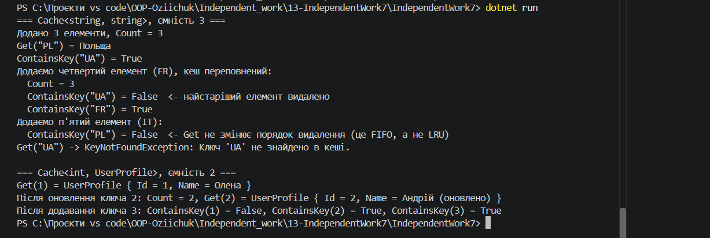
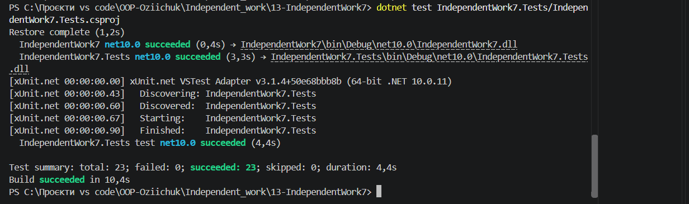

# Самостійна робота №13

**Студент:** Озійчук Ярослав  
**Тема:** Узагальнений кеш `Cache<TKey, TValue>` із тестами  

---

## Мета роботи
Розробити узагальнений клас кешу обмеженої ємності з політикою витіснення FIFO та покрити його юніт-тестами.

---

## Структура рішення

```text
IndependentWork7.sln
├── IndependentWork7/            консольний проєкт: Cache.cs, Program.cs
└── IndependentWork7.Tests/      проєкт xUnit-тестів (посилання на IndependentWork7)
```

Команди для створення (для довідки):

```bash
dotnet new console -n IndependentWork7
dotnet new xunit   -n IndependentWork7.Tests
dotnet new sln     -n IndependentWork7
dotnet sln add IndependentWork7 IndependentWork7.Tests
dotnet add IndependentWork7.Tests reference IndependentWork7
```

---

## Опис реалізації

### Клас `Cache<TKey, TValue>`

Приватні поля за завданням:

| Поле | Тип | Призначення |
|---|---|---|
| `_capacity` | `int` | максимальна кількість елементів |
| `_cache` | `Dictionary<TKey, TValue>` | зберігання пар «ключ - значення» |
| `_keysOrder` | `Queue<TKey>` | порядок додавання ключів (початок черги = найстаріший) |

Публічні члени: конструктор `Cache(int capacity)`, `Add`, `Get`, `ContainsKey`, `Count` (додатково `Capacity`).

Прийняті рішення:

1. **FIFO.** Якщо кеш повний і ключ новий, виконується `Dequeue()` (найстаріший ключ), а потім `Remove` цього ключа зі словника.
2. **Повторне додавання наявного ключа** лише оновлює значення. Позиція ключа в черзі не змінюється, тому в черзі немає дублікатів, а черга завжди містить рівно ті ж ключі, що й словник.
3. **`Get` не впливає на порядок видалення** (це FIFO, а не LRU) і використовує `TryGetValue`, щоб самостійно викинути `KeyNotFoundException` з зрозумілим повідомленням.
4. **Ємність ≤ 0** вважається помилкою: `ArgumentOutOfRangeException` у конструкторі.
5. Обмеження `where TKey : notnull`, бо `Dictionary` не приймає `null`-ключів.

---

## Юніт-тести (`CacheTests`, 23 тести, xUnit)

| Що перевіряється | Тести |
|---|---|
| Конструктор | нульова та від'ємна ємність → `ArgumentOutOfRangeException` |
| `Add` | новий елемент; кілька елементів у межах ємності; оновлення наявного ключа без зміни `Count`; оновлення не «омолоджує» ключ |
| `Get` | існуючий ключ; відсутній ключ → `KeyNotFoundException`; порожній кеш; витіснений ключ |
| `ContainsKey` | існуючий; відсутній; порожній кеш; після витіснення |
| `Count` | порожній кеш = 0; після додавання; ніколи не перевищує ємність |
| Політика FIFO | видалення найстарішого; збереження новіших; кілька переповнень підряд; ємність 1; `Get` не змінює порядок; рівно на межі ємності нічого не видаляється |

Запуск:

```bash
dotnet test
```

Очікуваний підсумок: `Passed: 23, Failed: 0`.

---

## Результат виконання програми





---

## Висновки

Реалізовано узагальнений кеш, який поєднує `Dictionary` (швидкий доступ за ключем, O(1)) і `Queue` (запам'ятовує порядок додавання). Видалення найстарішого елемента виконується за O(1). Окремі тести на кожен публічний член і на граничні випадки (ємність 1, рівно на межі ємності, повторні переповнення, оновлення наявного ключа) дозволяють швидко локалізувати помилку в політиці витіснення.

---

## Відповіді на контрольні запитання

1. **Переваги узагальненого кешу.** Один клас працює з будь-якими типами ключа й значення без дублювання коду; типобезпека перевіряється під час компіляції; немає боксингу значущих типів (на відміну від кешу на `object`) і зайвих приведень типів.
2. **Чому `Dictionary` + `Queue`/`LinkedList`.** `Dictionary` дає швидкий доступ за ключем, але не зберігає порядок додавання. Черга запам'ятовує порядок і дозволяє за O(1) дістати найстаріший ключ. Для LRU зручний `LinkedList`, бо в ньому можна за O(1) перемістити елемент у кінець.
3. **Виняток чи `TryGetValue`.** `Get`, який кидає `KeyNotFoundException`, доречний, коли відсутність ключа є помилкою логіки (ключ мав бути в кеші). Підхід `TryGetValue` (повертає `bool` та `out`-значення) краще, коли промах кешу є звичайною ситуацією (cache miss), яку очікують і обробляють без винятку, бо винятки дорогі.
4. **Критичні тести витіснення.** Видаляється саме найстаріший елемент, а не довільний; новіші елементи лишаються; `Count` ніколи не перевищує ємність; поведінка на межі (ємність 1 і рівно N елементів); кілька переповнень підряд; повторне додавання ключа не змінює порядок; читання не змінює порядок (для FIFO).
