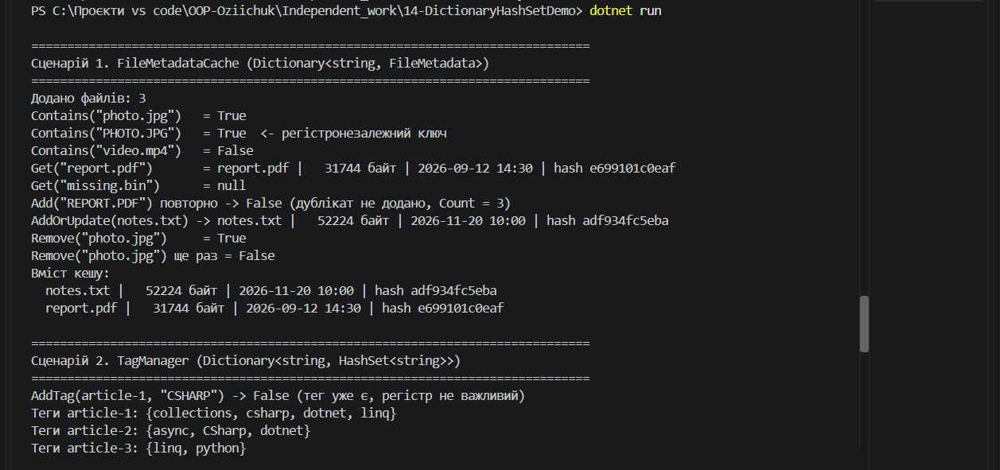
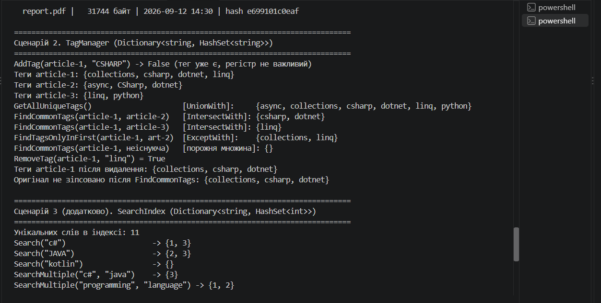
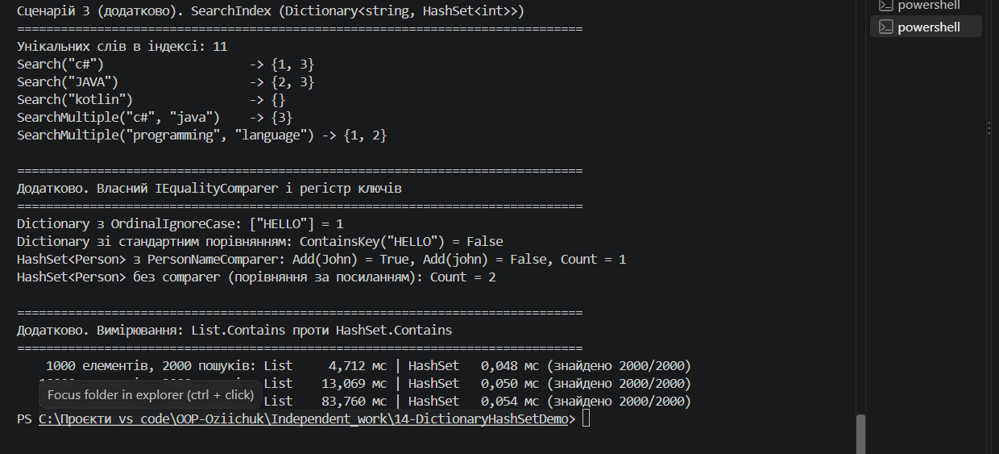

# Самостійна робота №14

**Студент:** Озійчук Ярослав  
**Тема:** Вивчення `Dictionary<TKey, TValue>` та `HashSet<T>` у бібліотеках .NET  

---

## Мета роботи
Дослідити використання узагальнених колекцій `Dictionary<TKey, TValue>` і `HashSet<T>` у популярних .NET-бібліотеках та застосувати їх у власних сценаріях.

> Аналіз open-source прикладів, порівняльна таблиця складності та висновки подані у файлі [`REPORT.md`](REPORT.md).

---

## Опис реалізації

Проєкт `DictionaryHashSetDemo`:

| Файл | Зміст |
|---|---|
| `Models/FileMetadata.cs` | метадані файлу: `FileName`, `Size`, `LastModified`, `Hash` |
| `Models/Person.cs` | `Person` і `PersonNameComparer : IEqualityComparer<Person>` (демонстрація власного comparer) |
| `Services/FileMetadataCache.cs` | **Сценарій 1:** `Dictionary<string, FileMetadata>` |
| `Services/TagManager.cs` | **Сценарій 2:** `Dictionary<string, HashSet<string>>` |
| `Services/SearchIndex.cs` | **Сценарій 3 (додатково):** `Dictionary<string, HashSet<int>>` |
| `Program.cs` | демонстрація сценаріїв, comparer-ів і порівняння `List` з `HashSet` |

### Сценарій 1. `FileMetadataCache`
- Ключ - ім'я файлу, словник створено з `StringComparer.OrdinalIgnoreCase`: `report.pdf` і `REPORT.PDF` вважаються одним файлом (як у Windows).
- `Add` повертає `false` для дубліката (через `TryAdd`), `AddOrUpdate` оновлює запис, `Get` повертає `null` за відсутності, `Remove` і `Contains` повертають `bool`.

### Сценарій 2. `TagManager`
- Для кожної статті - `HashSet<string>` тегів без урахування регістру (дублікат тега просто не додається).
- `GetAllUniqueTags` - об'єднання множин (`UnionWith`), `FindCommonTags` - перетин (`IntersectWith`), `FindTagsOnlyInFirst` - різниця (`ExceptWith`).
- Методи працюють із копіями множин, тому внутрішній стан не псується.

### Сценарій 3. `SearchIndex`
- Слово → множина ідентифікаторів документів; `SearchMultiple` будує перетин множин.

---

## Результат виконання програми

---

## Відповіді на контрольні запитання

1. **Переваги generic-колекцій.** Типобезпека на етапі компіляції, відсутність боксингу значущих типів і приведень, менше помилок виконання, зрозуміліший код.
2. **Коли що.** `Dictionary<TKey, TValue>` - коли значення потрібно знаходити за ключем (кеш, довідник, індекс). `HashSet<T>` - коли потрібні лише унікальні елементи та швидка перевірка належності, а також операції над множинами.
3. **Вплив `IEqualityComparer<T>`.** Він визначає, які ключі вважаються однаковими (регістр, поле об'єкта), тобто впливає на коректність. Він же задає `GetHashCode`: узгоджена й рівномірна хеш-функція дає O(1), а погана призводить до колізій і O(n).
4. **Чому `Dictionary<string, HashSet<int>>` для інвертованого індексу.** Словник за O(1) знаходить слово, а `HashSet<int>` зберігає ідентифікатори документів без повторів і дозволяє швидко знаходити їх перетин (AND) та об'єднання (OR).
