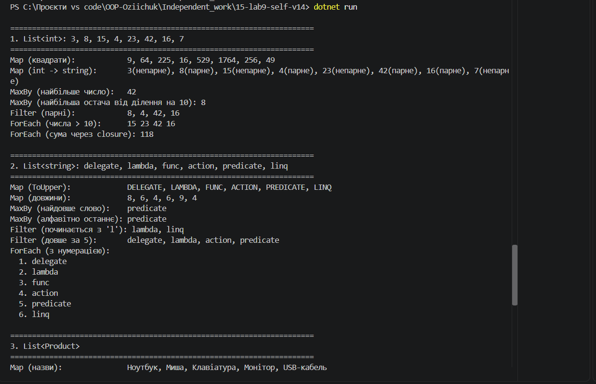
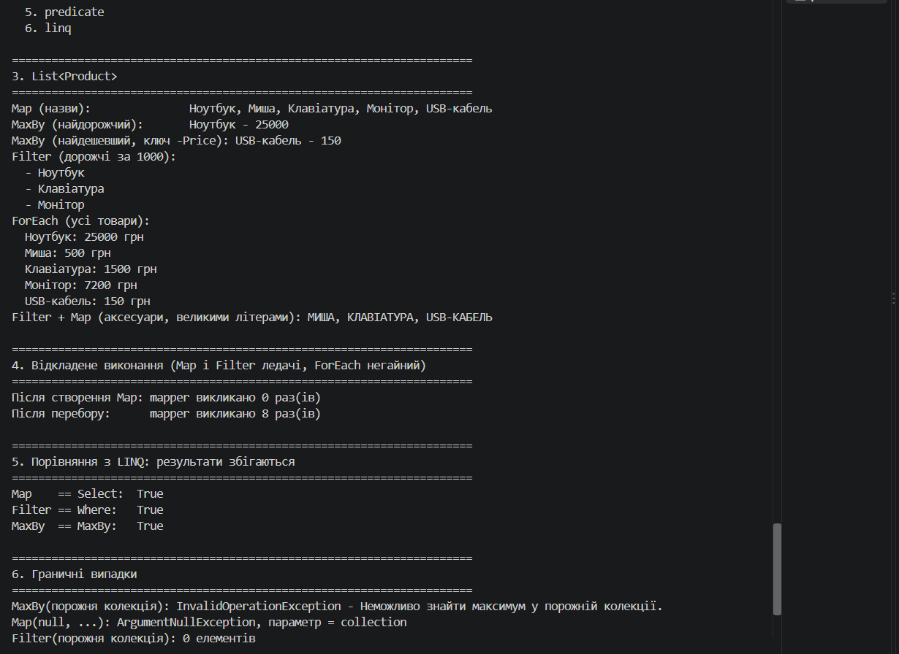

# Самостійна робота №15

**Студент:** Озійчук Ярослав  
**Тема:** Делегати й лямбда-вирази: власні утиліти для колекцій  

---

## Мета роботи
Поглибити розуміння делегатів та лямбда-виразів через створення власних узагальнених методів для роботи з колекціями.

---

## Опис реалізації

Проєкт `lab9-self-v14`. Статичний клас `CollectionUtils`:

| Метод | Делегат | Аналог LINQ | Виконання |
|---|---|---|---|
| `Map<TSource, TResult>(collection, mapper)` | `Func<TSource, TResult>` | `Select` | відкладене (`yield return`) |
| `MaxBy<T, TKey>(collection, keySelector)` | `Func<T, TKey>`, `where TKey : IComparable<TKey>` | `MaxBy` | негайне |
| `Filter<T>(collection, predicate)` | `Predicate<T>` | `Where` | відкладене (`yield return`) |
| `ForEach<T>(collection, action)` | `Action<T>` | `List<T>.ForEach` | негайне |

Рішення:
- Усі методи перевіряють аргументи на `null`. Для `Map` і `Filter` перевірка винесена з ітератора, тож виняток виникає одразу, а не під час першого перебору.
- `MaxBy` на порожній колекції кидає `InvalidOperationException` (замість мовчазного повернення `default`, що в прикладі з методички могло приховати помилку). Якщо максимумів кілька, повертається перший.
- Демонстрація використовує **три колекції**: `List<int>`, `List<string>`, `List<Product>`, різні лямбди (у тому числі з захопленням змінної, closure), ланцюжок `Filter` + `Map`, перевірку відкладеного виконання, порівняння з LINQ і граничні випадки.

---

## Результат виконання програми

---

## Звіт

### 1. Чому делегати корисні для створення таких утиліт?
Делегат дозволяє передати в метод **поведінку** як параметр. Алгоритм обходу колекції (цикл, перевірки, накопичення результату) пишеться один раз, а те, що саме робити з елементом (перетворити, перевірити умову, порівняти ключ), підставляє викликач. Без делегатів довелося б писати окремий метод для кожної умови (`GetExpensiveProducts`, `GetEvenNumbers` тощо) або окремий інтерфейс із класом на кожен випадок. Типи делегатів (`Func`, `Action`, `Predicate`) разом із generics роблять один і той самий код придатним для будь-яких типів елементів.

### 2. Як лямбда-вирази спрощують виклик цих методів?
Лямбда дозволяє записати поведінку прямо в місці виклику, без окремого іменованого методу чи класу:
`CollectionUtils.Filter(products, p => p.Price > 1000)` замість оголошення окремої функції й передавання її імені. Типи параметрів виводяться компілятором, код коротший і читається разом із контекстом. Лямбди також можуть **захоплювати локальні змінні** (closure): у програмі `sum += n` усередині `ForEach` накопичує суму у змінній зовнішнього методу.

### 3. Порівняння власних методів із LINQ

| Власний метод | LINQ | Відмінності |
|---|---|---|
| `Map` | `Select` | поведінка однакова (відкладене виконання); LINQ має ще перевантаження з індексом елемента і оптимізації для масивів і списків |
| `Filter` | `Where` | поведінка однакова; LINQ приймає `Func<T, bool>`, а наш метод - `Predicate<T>` (за суттю те саме, але різні типи делегатів) |
| `MaxBy` | `MaxBy` (.NET 6+) | LINQ-версія приймає необов'язковий `IComparer<TKey>` і не вимагає `IComparable<TKey>`; на порожній колекції для типів-посилань повертає `null`, наш метод кидає виняток |
| `ForEach` | немає для `IEnumerable<T>` (є лише `List<T>.ForEach`) | свідомо відсутній у LINQ, бо LINQ-оператори мають бути без побічних ефектів, а `ForEach` ці ефекти і виконує |

Програма перевіряє збіг результатів: `Map == Select`, `Filter == Where`, `MaxBy == MaxBy` (усі `True`).

---

## Висновки

Узагальнені методи, що приймають делегати, дозволяють один раз реалізувати обхід колекції й повторно використовувати його з будь-якою логікою через лямбда-вирази. Власні `Map`, `Filter`, `MaxBy` повторюють поведінку відповідних операторів LINQ (зокрема відкладене виконання для `Map` і `Filter`), що допомагає зрозуміти, як LINQ працює зсередини. У реальних проєктах доцільно користуватися готовим LINQ, а власні утиліти варто писати для навчання, для спеціалізованої поведінки або коли потрібен контроль над виконанням.

---

## Відповіді на контрольні запитання

1. **Чому делегати зручні для передавання поведінки.** Вони типізовані й дозволяють передати функцію як значення, тому узагальнений метод не знає, що саме робитиме з елементом, і працює для будь-якої логіки.
2. **`Func`, `Action`, `Predicate`.** `Func<T, TResult>` приймає параметри й **повертає** значення; `Action<T>` приймає параметри й **нічого не повертає**; `Predicate<T>` приймає один параметр і повертає `bool` (за суттю `Func<T, bool>`).
3. **Переваги поєднання generics і лямбд.** Мінімум коду на виклик, типобезпека, повторне використання одного алгоритму для різних типів, можливість будувати ланцюжки (`Filter` → `Map`).
4. **Коли варто писати власні утиліти.** Для навчання; коли потрібна спеціальна поведінка (інший спосіб обробки порожніх колекцій, логування, обмеження); коли LINQ недоступний; коли потрібен контроль над виконанням (наприклад, уникнути виділення пам'яті на гарячому шляху).
