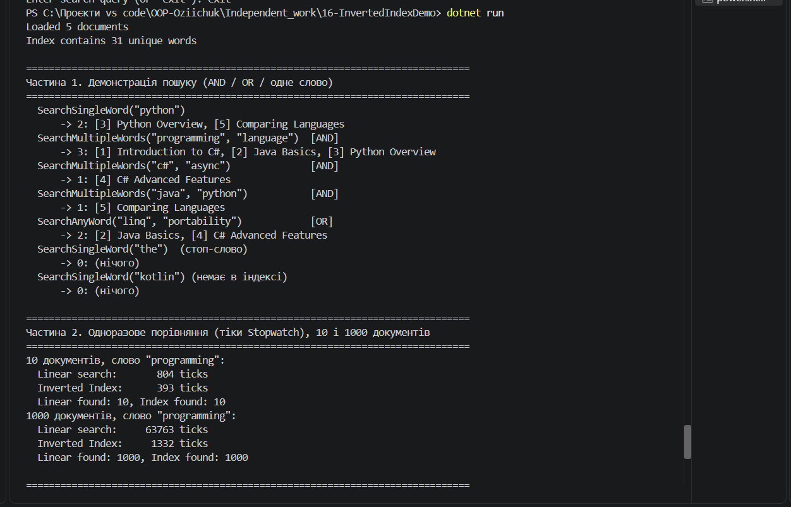
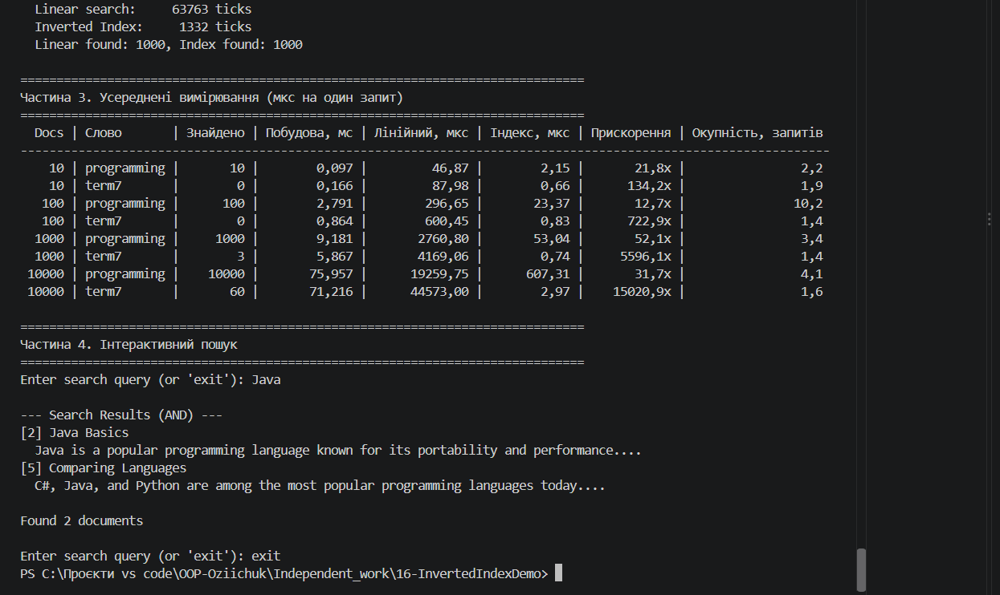

# Самостійна робота №16

**Студент:** Озійчук Ярослав  
**Тема:** Колекції в практиці ООП: інвертований індекс і вимірювання продуктивності  

---

## Мета роботи
Розробити власну реалізацію інвертованого індексу для повнотекстового пошуку та порівняти продуктивність лінійного пошуку з пошуком через індекс.

> Опис реалізації, таблиця вимірювань для 10/1000 (і 100/10000) документів, висновки та відповіді на контрольні запитання - у файлі [`REPORT.md`](REPORT.md).

---

## Короткий опис

- `InvertedIndex` на основі `Dictionary<string, HashSet<int>>` з методами `SearchSingleWord`, `SearchMultipleWords` (AND, `IntersectWith`) і `SearchAnyWord` (OR, `UnionWith`).
- `TextProcessor` (`Tokenize`, `RemoveStopWords`) з єдиною нормалізацією для індексу, запитів і лінійного пошуку.
- `PerformanceTest`: порівняння лінійного пошуку та індексу з перевіркою збігу кількості результатів.
- Інтерактивний пошук у консолі (AND-пошук за введеними словами; команда `exit` завершує програму).

### Запуск

```bash
cd InvertedIndexDemo
dotnet run
```

Для швидкої перевірки без ручного введення:

```bash
printf 'programming language\nc# async\nkotlin\nexit\n' | dotnet run
```

---

## Приклад виводу програми




