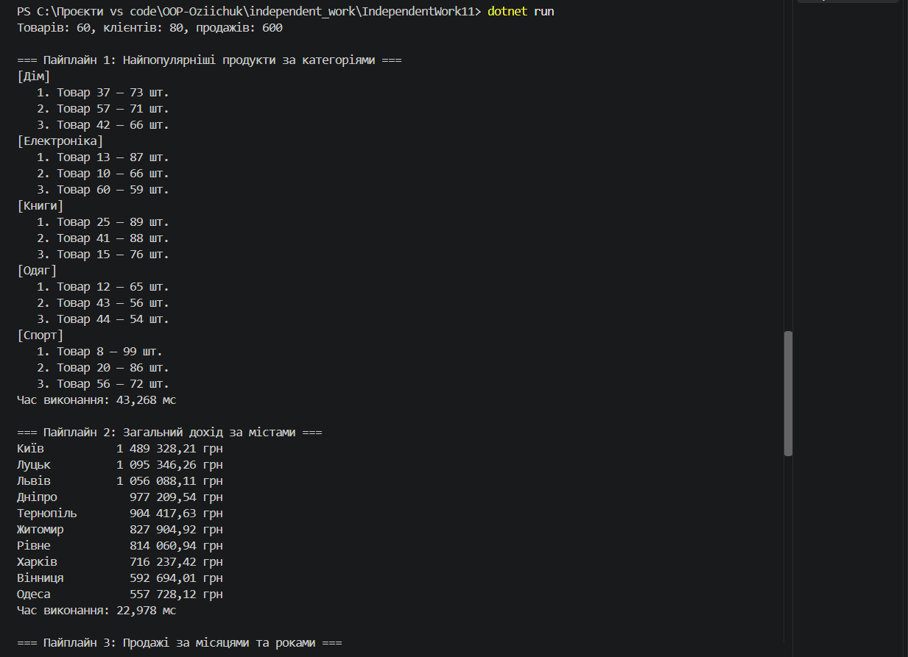
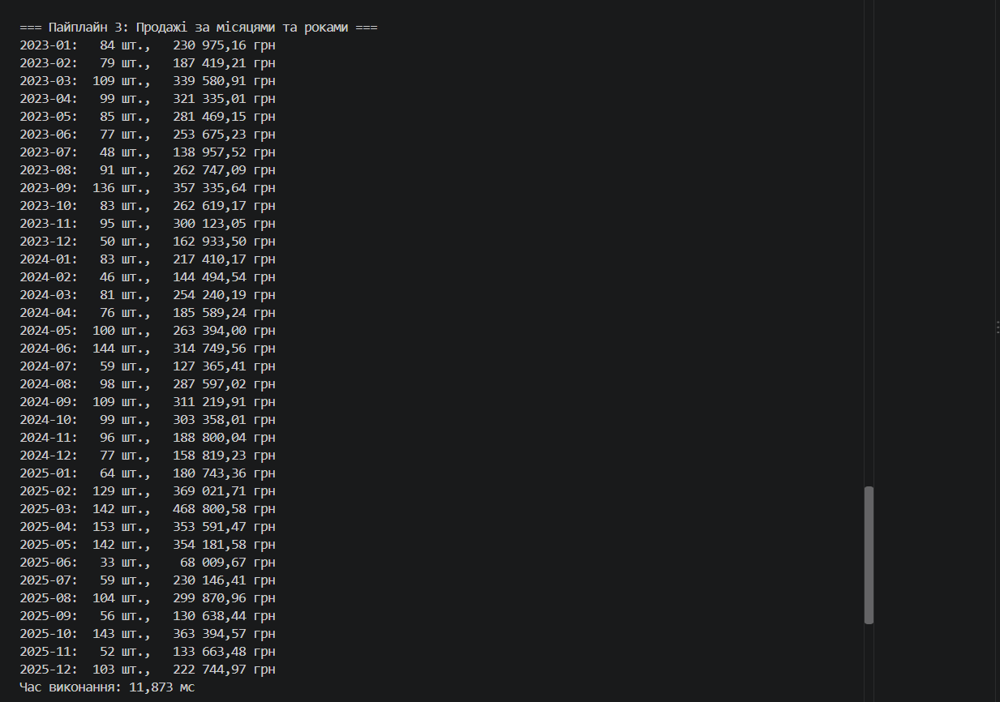
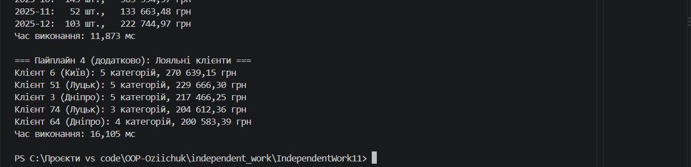

# Самостійна робота №17

**Студент:** Озійчук Ярослав  
**Варіант:** 14  
**Тема:** LINQ pipelines: ETL та аналітика  

---

## Мета роботи
Розробити та проаналізувати складні LINQ-пайплайни для обробки даних, що імітують сценарії ETL (Extract, Transform, Load) та аналітики, використовуючи різні оператори LINQ.

---

## Опис реалізації

У проєкті `IndependentWork11` реалізовано сценарій «Продажі».

### Файли проєкту

1. **`Models.cs`** — сутності `Sale` (Id, ProductId, Quantity, SaleDate, CustomerId), `Product` (Id, Name, Category, UnitPrice), `Customer` (Id, Name, City).
2. **`DataGenerator.cs`** — генерує тестові дані: 60 товарів у 5 категоріях, 80 клієнтів у 10 містах, 600 продажів за 2023–2025 роки. Використовується `new Random(14)` (14 — номер варіанта), тому результати відтворювані.
3. **`SalesAnalytics.cs`** — клас із LINQ-пайплайнами, кожен оформлений окремим методом.
4. **`Program.cs`** — генерація даних та запуск пайплайнів; для кожного створюється **власний** `Stopwatch`.

### Пайплайни

| № | Метод | Мета | Оператори |
|---|-------|------|-----------|
| 1 | `TopProductsByCategory()` | Топ-3 продукти кожної категорії за кількістю | `GroupBy`, `Select`, `Sum`, `Join`, `OrderByDescending`, `Take` |
| 2 | `RevenueByCity()` | Дохід за містами клієнтів | `Join` ×2, `GroupBy`, `Sum`, `OrderByDescending` |
| 3 | `SalesByMonth()` | Кількість і дохід за роком та місяцем | `Join`, `GroupBy` (за складеним ключем), `Sum`, `OrderBy`, `ThenBy` |
| 4* | `LoyalCustomers()` | Топ-5 клієнтів, що купували щонайменше у 3 категоріях | `Join`, `GroupBy`, `Distinct`, `Count`, `Where`, `OrderByDescending`, `Take` |

\* пайплайн 4 — додатковий.

Кожен метод повертає **матеріалізований** `List<string>` (через `ToList()`), тому `Stopwatch` вимірює виконання всього запиту, а не лише побудову відкладеного (lazy) виразу.

---

## Результат виконання програми

---

## Аналіз продуктивності

На час виконання пайплайнів впливають такі фактори:

- **JIT-компіляція.** Перший пайплайн зазвичай найповільніший, бо при першому виконанні компілюються загальні методи LINQ.
- **Кількість операцій `Join` і `GroupBy`.** Вони будують хеш-таблиці та проміжні колекції (пайплайни 2–4 мають по кілька з'єднань).
- **Обсяг даних.** Для 600 продажів різниця між пайплайнами — мікросекунди/мілісекунди, на великих обсягах вона стала б помітною.
- **Відкладене виконання.** Без `ToList()` вимірювання б показало майже нуль.
- **Сортування й `Distinct`** додають складність O(n log n) та додаткову пам'ять.
- **Збирач сміття та навантаження ОС** створюють розкид між запусками.

## Висновок

LINQ дозволяє описати складну аналітику (з'єднання трьох колекцій, групування, агрегацію й сортування) декларативно, кількома рядками, замість вкладених циклів із ручними словниками. Пайплайни легко читаються й розширюються, а виділення кожного в окремий метод з промовистою назвою зберігає `Main` коротким. Для невеликих обсягів (сотні записів) продуктивність LINQ більш ніж достатня; для мільйонів записів варто зважати на додаткові виділення пам'яті, а дані з БД краще обробляти на стороні сервера (LINQ to SQL/EF), а не завантажувати в пам'ять.

---

## Відповіді на контрольні запитання

1. **Переваги LINQ для ETL порівняно з циклами.** Декларативність («що», а не «як»), менше коду, єдиний синтаксис для різних джерел, легка композиція кроків (Extract → Transform → Load), відкладене виконання, менша ймовірність помилок із лічильниками й проміжними змінними.
2. **Чому поєднують `Join`, `GroupBy`, `Select`, `OrderBy`.** Дані аналітики розподілені по кількох сутностях: `Join` збирає потрібні поля, `GroupBy` формує групи, `Select` обчислює агрегати (сума, кількість) та формує проєкцію, `OrderBy` упорядковує результат для звіту.
3. **Фактори впливу на продуктивність.** Обсяг даних, кількість і порядок операторів (фільтрувати `Where` краще раніше), повторні перебори однієї послідовності, матеріалізація (`ToList`), складність ключів групування й порівняння, сортування, виділення пам'яті та робота GC.
4. **Як перевірити читабельність і підтримуваність.** Виносити пайплайни в окремі методи з зрозумілими назвами, не робити надто довгих ланцюжків, давати осмислені імена проміжним змінним/анонімним полям, покривати запити юніт-тестами на фіксованих даних, проводити code review.
