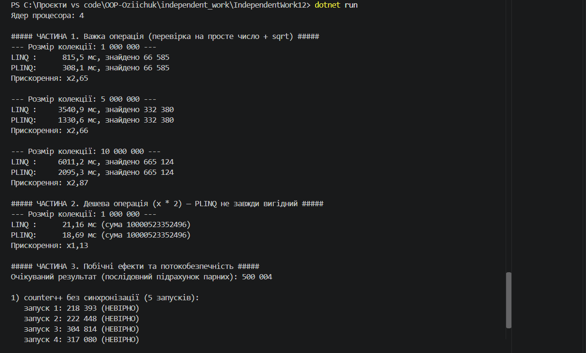
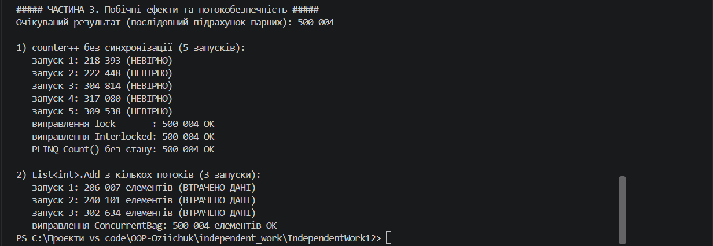

# Самостійна робота №18

**Студент:** Озійчук Ярослав  
**Варіант:** 14  
**Тема:** PLINQ: дослідження продуктивності та безпеки  

---

## Мета роботи
Дослідити переваги та недоліки PLINQ (Parallel LINQ) у порівнянні зі звичайним LINQ, виміряти його продуктивність на різних обсягах даних та проаналізувати потенційні проблеми безпеки при паралельній обробці.

---

## Опис реалізації

У проєкті `IndependentWork12` один файл `Program.cs`, що складається з трьох частин.

### Частина 1. Важка операція
- Колекція `List<int>` з випадкових чисел від 2 до 10 000 000 (`new Random(14)`).
- Операція: `Where(IsPrime).Select(n => Math.Sqrt(n))`, де `IsPrime` — перевірка на просте число діленням до √n.
- Порівнюються `LINQ` і `AsParallel()` (PLINQ) на розмірах **1 000 000**, **5 000 000** (необов'язковий) і **10 000 000** елементів. Час вимірюється `Stopwatch`; перед тестами виконується прогрів JIT.

### Частина 2. Дешева операція
`Select(n => (long)n * 2).Sum()` на 1 млн елементів — щоб показати, що для простих операцій накладні витрати на розбиття даних і синхронізацію можуть звести виграш PLINQ нанівець.

### Частина 3. Побічні ефекти
- **Спільний лічильник** `counter++` у `ForAll` без синхронізації: інкремент неатомарний (читання → збільшення → запис), тому потоки затирають зміни одне одного й результат менший за очікуваний та різний між запусками. Виправлення: `lock`, `Interlocked.Increment`, або (найкраще) взагалі без спільного стану — `Count()`.
- **Спільний `List<int>`**: `List<T>` не потокобезпечний, паралельні `Add` можуть втратити елементи або викинути виняток. Виправлення: `ConcurrentBag<int>`.

---

## Результат виконання програми
ss

---

## Аналіз

- **Коли PLINQ швидший.** Для обчислювально важкої операції (перевірка на простоту) на мільйонах елементів: робота на елемент велика, елементи незалежні, тож її вигідно розподілити між ядрами. Виграш зростає зі збільшенням розміру колекції, бо накладні витрати розподіляються на більшу роботу, але обмежений кількістю ядер.
- **Коли ні.** Для дешевої операції (`x * 2`) на невеликому обсязі PLINQ часто повільніший чи не швидший: час іде на розбиття джерела, планування потоків та злиття результатів.
- **Порядок.** `AsParallel()` не гарантує збереження порядку (для цього є `AsOrdered()`, що коштує продуктивності).
- **Побічні ефекти.** Стан, спільний між потоками, без синхронізації дає гонку даних. Найкраще — писати запити як «чисті» (без побічних ефектів) та користуватися вбудованими агрегаціями; `lock` працює, але серіалізує код і зменшує виграш від паралелізму; `Interlocked` швидший за `lock` для простих лічильників; `ConcurrentBag` — для збирання результатів.

## Висновок

PLINQ — зручний спосіб прискорити обчислювально інтенсивні запити практично без зміни коду, але він не є «безкоштовним»: на дешевих операціях і малих колекціях він може програвати звичайному LINQ, тож рішення потрібно ухвалювати за вимірюваннями (на кількох розмірах даних), а не припущеннями. Крім того, паралельний код вимагає потокобезпечності: побічні ефекти в лямбдах призводять до непередбачуваних результатів, тому слід уникати спільного змінюваного стану або захищати його (`lock`, `Interlocked`, `Concurrent*`-колекції).

---

## Відповіді на контрольні запитання

1. **Коли PLINQ дає виграш.** Коли операція над кожним елементом обчислювально важка, елементи незалежні, колекція велика, є кілька ядер процесора, а запит не залежить від порядку й не має побічних ефектів.
2. **Чому побічні ефекти небезпечні.** Лямбди виконуються одночасно в різних потоках; зміна спільних даних без синхронізації призводить до гонки даних (втрачені оновлення, пошкоджені колекції, винятки), а порядок виконання недетермінований.
3. **Навіщо кілька розмірів колекції.** Виграш залежить від співвідношення корисної роботи та накладних витрат паралелізації; один розмір може випадково показати і перевагу, і програш. Кілька розмірів показують тенденцію й поріг, з якого PLINQ окупається.
4. **Що робити, якщо PLINQ повільніший.** Зробити висновок, що для цієї операції/обсягу накладні витрати перевищують виграш: операція надто дешева, колекція замала, є синхронізація або тиск на пам'ять. Тоді слід лишити звичайний LINQ (або збільшити вагу операції на елемент / змінити гранулярність), а не застосовувати PLINQ за замовчуванням.
