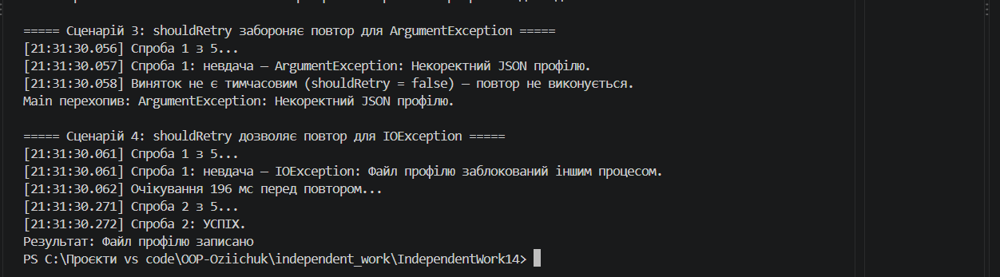
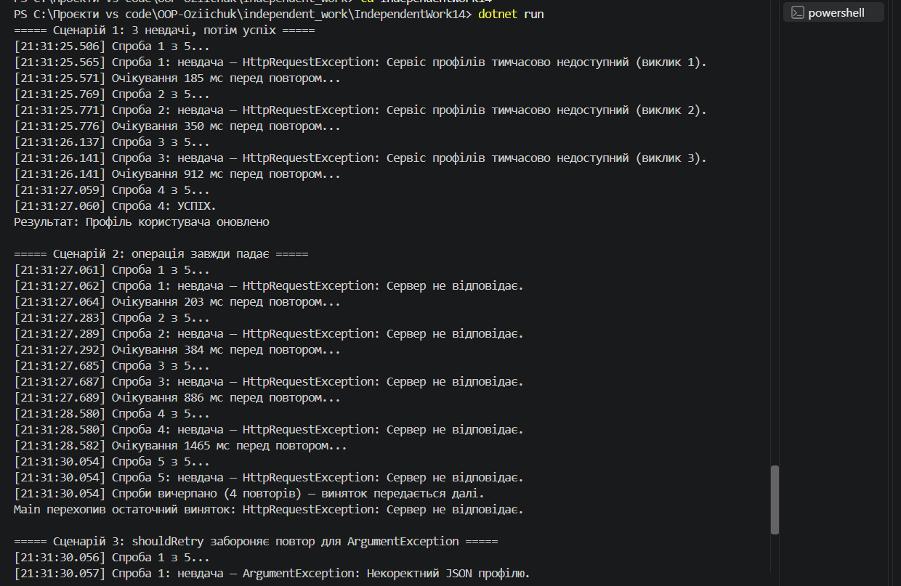

# Самостійна робота №20

**Студент:** Озійчук Ярослав  
**Варіант:** 14  
**Тема:** Реалізація exponential backoff  

---

## Мета роботи
Розробити власний допоміжний клас для реалізації патерну Retry з експоненційною затримкою та випадковим «jitter».

---

## Опис реалізації

У проєкті `IndependentWork14` реалізовано сценарій оновлення профілю користувача (узгоджено з варіантом 14).

### Клас `RetryPolicy`

- Приватні поля: `_maxRetries` (int), `_initialDelay` (TimeSpan), `_jitterFactor` (double).
- Конструктор: `RetryPolicy(int maxRetries, TimeSpan initialDelay, double jitterFactor = 0.2)` із перевіркою аргументів (`ArgumentOutOfRangeException`).
- Метод: `T Execute<T>(Func<T> operation, Func<Exception, bool>? shouldRetry = null)` — узагальнений, працює з будь-якою `Func<T>`.
- Усього спроб: `maxRetries + 1` (перша + повтори).
- Затримка за формулою із завдання:

```csharp
delay = initialDelay * Math.Pow(2, retryAttempt)
        * (1 + random.NextDouble() * jitterFactor * 2 - jitterFactor);
```

  Множник jitter лежить у межах `[1 - jitterFactor; 1 + jitterFactor]`, тобто ±20 % за замовчуванням.
- `shouldRetry` вирішує, чи повторювати спробу для конкретного винятку. Якщо він не заданий — повторюється будь-який виняток. Якщо він повернув `false` або повтори вичерпано, виняток передається далі через `throw;` (зберігається оригінальний стек викликів).
- Кожна спроба, причина невдачі, затримка та підсумок логуються через `Console.WriteLine` із часовою позначкою.

### Параметри та сценарії в `Main`

Параметри: `maxRetries = 4`, `initialDelay = 200 мс`, `jitterFactor = 0.2`. Орієнтовні затримки: 200 мс (160–240), 400 мс (320–480), 800 мс (640–960), 1600 мс (1280–1920).

1. Операція падає 3 рази (`HttpRequestException`), на 4-й спробі успіх.
2. Операція завжди падає — після вичерпання спроб виняток потрапляє в `Main`.
3. `shouldRetry` не дозволяє повторювати `ArgumentException` (некоректні дані) — лише 1 спроба.
4. `shouldRetry` дозволяє повторити `IOException` — успіх на 2-й спробі.

---

## Результат виконання програми





---

## Висновок

Експоненційна затримка збільшується вдвічі після кожної невдачі, тож сервіс отримує дедалі більше часу на відновлення й не засипається частими запитами, а jitter розсинхронізовує клієнтів, щоб вони не повторювали запити одночасно. Retry з exponential backoff доречний лише для **тимчасових** збоїв (обрив зв'язку, 503, заблокований файл) та **ідемпотентних** операцій. Його не слід застосовувати до постійних помилок (некоректні дані, відсутність прав, 4xx) — для цього служить `shouldRetry`, а також до неідемпотентних операцій без захисту (ризик подвійного списання/створення). Крім того, повтори збільшують загальний час відповіді, а при тривалому падінні сервісу краще доповнити їх Circuit Breaker та обмеженням загального часу. `Thread.Sleep` блокує потік, тому для UI/серверних застосунків краще асинхронна версія з `Task.Delay`.

---

## Відповіді на контрольні запитання

1. **Чому експоненційна затримка ефективніша за фіксовану.** Короткі паузи на початку швидко виправляють короткочасні збої, а зростання пауз дає перевантаженому сервісу час на відновлення й зменшує навантаження від повторів; фіксована затримка або марнує час, або продовжує «бити» по сервісу з тією ж інтенсивністю.
2. **Для чого jitter.** Без нього багато клієнтів, які впали одночасно, повторюють запити в той самий момент («thundering herd») і знову перевантажують сервіс. Випадкова складова розподіляє повтори в часі.
3. **Роль `shouldRetry`.** Дозволяє повторювати лише тимчасові винятки (наприклад, `HttpRequestException`, `IOException`), а постійні (`ArgumentException`, відмова в доступі) одразу передавати далі, не витрачаючи час на безглузді повтори.
4. **Коли повтор небезпечний.** Для неідемпотентних операцій (платіж, створення замовлення, надсилання листа) без ключа ідемпотентності; для постійних помилок (невалідні дані, автентифікація, 4xx); коли сервіс явно перевантажений і повтори погіршать ситуацію; коли загальний час повторів перевищує допустимий для користувача.
