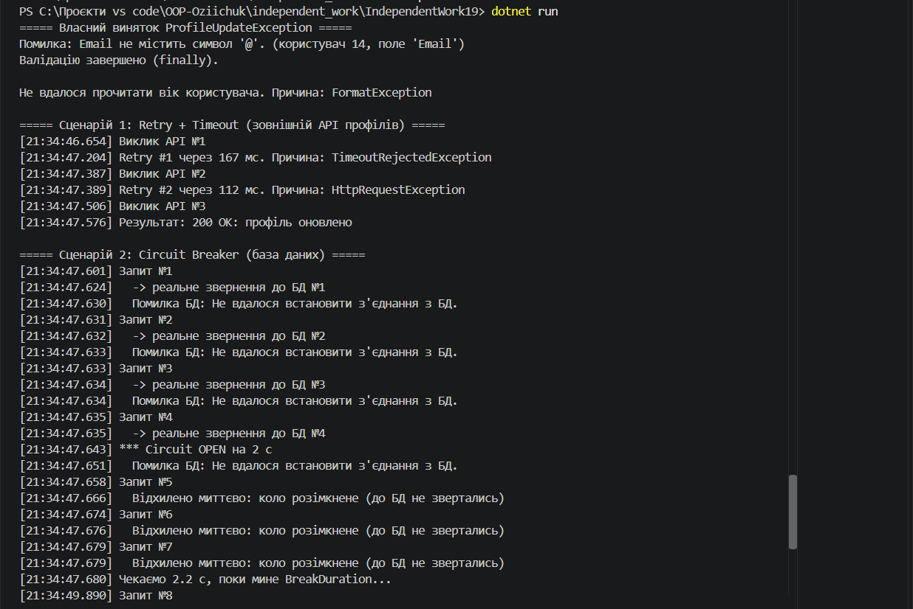
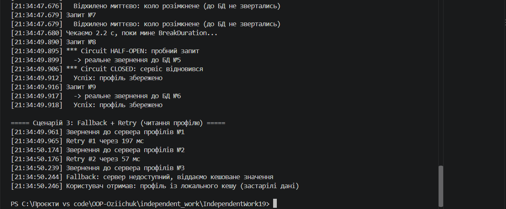

# Самостійна робота №19

**Студент:** Озійчук Ярослав  
**Варіант:** 14  
**Тема:** Дизайн винятків і політики retry: теорія та кейси Polly  

---

## Мета роботи
Опрацювати теорію обробки винятків у .NET (try-catch-finally, власні типи винятків, виняток чи Result), вивчити патерни відмовостійкості (Retry, Circuit Breaker, Bulkhead) та бібліотеку Polly, реалізувати практичні сценарії.

---

## Опис реалізації

Проєкт `IndependentWork19` використовує NuGet-пакет **Polly 8.4.1** та актуальний API `ResiliencePipelineBuilder`. Предметна область — профіль користувача (варіант 14).

### Власний виняток (`CustomExceptions.cs`)

`ProfileUpdateException : Exception` із властивостями `UserId` та `FieldName` і конструкторами: без параметрів, з `message`, з `message` та `innerException`, а також розширений `(message, userId, fieldName)`. У `Main` демонструється `try-catch-finally` та обгортання внутрішнього винятку (`FormatException`). Також є допоміжний `DatabaseUnavailableException` для сценарію 2.

### Сценарій 1. Зовнішній API профілів: Retry + Timeout

- **Проблема:** API може відповісти помилкою 503 або «зависнути».
- **Стратегія:** Retry (3 повтори, експоненційна затримка 200 мс, jitter) + Timeout 500 мс на кожну спробу. Retry додано першим, тому він зовнішній і обгортає Timeout. Обробляються `HttpRequestException` та `TimeoutRejectedException`.
- **Вивід:** 1-й виклик перевищує таймаут → Retry #1; 2-й виклик — 503 → Retry #2; 3-й — успіх.

```csharp
var pipeline = new ResiliencePipelineBuilder()
    .AddRetry(new RetryStrategyOptions {
        ShouldHandle = new PredicateBuilder().Handle<HttpRequestException>().Handle<TimeoutRejectedException>(),
        MaxRetryAttempts = 3, Delay = TimeSpan.FromMilliseconds(200),
        BackoffType = DelayBackoffType.Exponential, UseJitter = true,
        OnRetry = args => { /* лог */ return default; } })
    .AddTimeout(TimeSpan.FromMilliseconds(500))
    .Build();
```

### Сценарій 2. База даних: Circuit Breaker

- **Проблема:** БД недоступна тривалий час; повтори лише навантажують її та затримують користувачів.
- **Стратегія:** Circuit Breaker (`FailureRatio = 0.5`, `MinimumThroughput = 4`, `BreakDuration = 2 с`) — це не Retry: він припиняє звернення до сервісу, що «впав».
- **Вивід:** запити 1–4 звертаються до БД і падають → `OPEN`; запити 5–7 відхиляються миттєво (`BrokenCircuitException`, до БД не звертаються); після 2.2 с — `HALF-OPEN`, пробний запит успішний → `CLOSED`; запит 9 проходить нормально.

### Сценарій 3. Читання профілю: Fallback + Retry

- **Проблема:** сервер профілів недоступний, але застосунок має щось показати.
- **Стратегія:** Retry (2 повтори) всередині, Fallback зовні: коли повтори вичерпано, віддається профіль із локального кешу.
- **Вивід:** 3 звернення до сервера (1 + 2 повтори), далі повідомлення Fallback і результат «профіль із локального кешу».

---

## Результат виконання програми






---

## Виняток чи Result<T>

Виняток слід кидати, коли ситуація справді виняткова й метод не може виконати свій контракт (файл не знайдено, розірване з'єднання з БД, пошкоджені дані). Result (або `bool`, `null`, спеціальний тип) краще повертати для **очікуваних** невдач, які закономірно трапляються в нормальному потоці: валідація введення, пошук елемента, що може не існувати, порушення бізнес-правила. Винятки не можна непомітно проігнорувати й дають стек викликів, але повільніші; Result швидший і явний у сигнатурі, але результат можна забути перевірити.

## Висновок

Polly дозволяє винести політики відмовостійкості з бізнес-логіки в декларативні pipeline-и: Retry, Timeout, Circuit Breaker і Fallback комбінуються в одному ланцюжку (важливий порядок: перша доданa стратегія — зовнішня). Бібліотека має готові jitter, експоненційний backoff, події (`OnRetry`, `OnOpened`) для логування й асинхронну підтримку. Обмеження: додаткова залежність і складність налаштування (неправильні пороги дають надто «чутливий» або «сліпий» breaker); Polly не робить небезпечну операцію безпечною (неідемпотентні операції з Retry без ключа ідемпотентності можуть виконатися двічі); Fallback може віддавати застарілі дані; а повтори збільшують латентність.

---

## Відповіді на контрольні запитання

1. **Виняток чи Result.** Виняток — для порушення контракту методу (`File.ReadAllText` на неіснуючому файлі → `FileNotFoundException`). Result — для очікуваної невдачі (`int.TryParse` повертає `false`; пошук користувача повертає `null`/`Result.Fail`).
2. **Три стандартні конструктори:** без параметрів; з `string message`; з `string message, Exception innerException`.
3. **Circuit Breaker vs Retry.** Retry повторює операцію в сподіванні, що збій короткочасний; Circuit Breaker після серії помилок «розмикає коло» й відхиляє запити без звернення до сервісу. Retry доцільний для швидких випадкових збоїв, Circuit Breaker — коли сервіс, ймовірно, недоступний тривалий час. Їх часто поєднують.
4. **Bulkhead.** Ізолює ресурси (потоки, з'єднання) між операціями, обмежуючи кількість одночасних викликів, щоб збій чи повільність однієї залежності не вичерпали ресурси всього застосунку.
5. **Чому важливий jitter.** Він розсинхронізує повтори клієнтів: без нього всі повторюють запити в однакові моменти й створюють «шторм», що повторно перевантажує сервіс.
6. **Ризики Retry для неідемпотентної операції.** Операція може виконатися кілька разів: подвійне списання коштів, дублікати замовлень чи листів, якщо перший запит насправді пройшов, але відповідь загубилась. Потрібні ключі ідемпотентності або заборона повторів.
