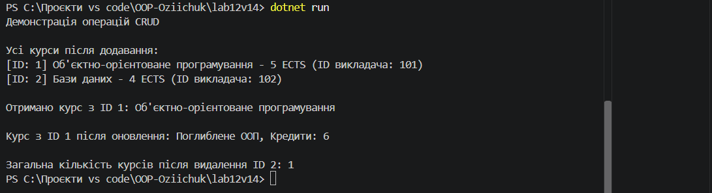
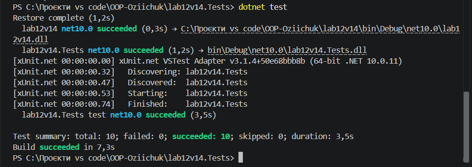

# Лабораторна робота №7

**Студент:** Озійчук Ярослав
**Варіант:** 14
**Тема:** Узагальнені типи (Generics). IRepository з where-обмеженнями та тестами.  

---

## Мета роботи
Навчитися створювати узагальнені інтерфейси та класи, застосовувати `where`-обмеження для типів-параметрів, а також розробляти юніт-тести для перевірки коректності узагальнених реалізацій.

---

## Опис реалізації

Проєкт розділено на два основні модулі: консольний застосунок `lab12v14` та тестовий проєкт `lab12v14.Tests.

1. **Інтерфейс `IEntity`**: Визначено базовий контракт для сутностей із властивістю `int Id { get; set; }`.
2. **Сутність `Course` (Варіант 14)**: Реалізує інтерфейс `IEntity`та містить властивості:
   - `Title` (string) — назва курсу;
   - `Credits` (int) — кількість кредитів ECTS;
   - `TeacherId` (int) — ідентифікатор викладача.
3. **Узагальнений інтерфейс `IRepository<T>`**: Визначає базові CRUD-операції (`GetById`, `GetAll`, `Add`, `Update`, `Delete`) із обмеженням `where T : class, IEntity`.
4. **Клас `InMemoryRepository<T>`**: Реалізація `IRepository<T>` для збереження даних у пам'яті (на основі `List<T>`)з обробкою виняткових ситуацій (дублювання ID, пошук чи видалення неіснуючих елементів).
5. **Тестовий проєкт `lab12v14.Tests`**: Містить 10 юніт-тестів на базі фреймворку **xUnit**, які повністю покривають усі CRUD-операції та граничні випадки для `InMemoryRepository<T>`.

У `Program.cs` продемонстровано роботу сховища з об'єктами класу `Course`.

---

## Результат виконання програми

### Демонстрація роботи консольного застосунку:

### Результат проходження юніт-тестів:

---

## Відповіді на контрольні запитання

**1. Яка роль `where`-обмежень у Generics? Наведіть приклади їх використання.**  
`where`-обмеження (type constraints) звужують множину типів, які можна передати як параметр у узагальнений клас або метод. Це дозволяє безпечно звертатися до методів і властивостей цих типів усередині узагальненої реалізації.  
*Приклади:*
- `where T : class` — тип `T` має бути посилальним типом;
- `where T : struct` — тип `T` має бути типом значення;
- `where T : new()` — тип `T` повинен мати публічний конструктор без параметрів;
- `where T : IEntity` — тип `T` повинен реалізовувати інтерфейс `IEntity`.

**2. Навіщо потрібен шаблон `IRepository`? Які переваги він дає?**  
Шаблон `IRepository` абстрагує рівень доступу до даних (Data Access Layer) від бізнес-логіка.
- **Розділення відповідальностей (Separation of Concerns):** Бізнес-логіка не залежить від конкретної реалізації збереження даних (база даних, файл або пам'ять).
- **Тестованість (Testability):** Дозволяє легко підміняти реальну базу даних на `InMemoryRepository` під час написання юніт-тестів.
- **Повторне використання коду:** Стандартна логіка CRUD-операцій реалізується один раз для всіх сутностей.

**3. Поясніть, чому юніт-тести є важливими при розробці узагальнених компонентів.**  
Оскільки узагальнені (generic) компоненти призначені для роботи з найрізноманітнішими типами даних, вони мають бути універсальними та надійними. Юніт-тести дозволяють автоматично перевірити, чи коректно обробляються базові операції та граничні випадки (дублювання ключа, відсутність елемента, повернення `null`).

**4. Які проблеми вирішують Generics порівняно з використанням `object`?**  
- **Типобезпека (Type Safety):** Помилки невідповідності типів виявляються під час компіляції, а не під час виконання (Runtime Exception).
- **Продуктивність (Performance):** Уникаються витратні операції упаковки/розпаковки (boxing/unboxing) для типів значень (`struct`).
- **Чистота коду:** Зникає потреба в постійному явному приведенні типів.