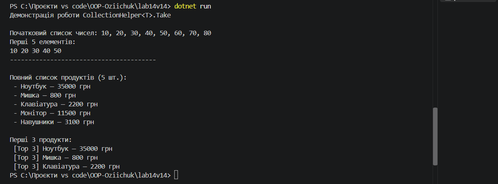

# Лабораторна робота №8

**Студент:** Озійчук Ярослав  
**Варіант:** 14  
**Тема:** Делегати й лямбда-вирази у практиці колекцій: CollectionHelper<T>  

---

## Мета роботи
Навчитися передавати поведінку як параметр через делегати `Func`, `Action`, `Predicate`, будувати на цій основі універсальні операції над колекціями та використовувати лямбда-вирази.

---

## Опис реалізації

Узагальнений статичний клас **`CollectionHelper<T>`** реалізує метод **`Take`** згідно з варіантом 14:

public static IEnumerable<T> Take(IEnumerable<T> collection, int count)

Особливості реалізації:

Метод не використовує готовий LINQ-оператор .Take(), а реалізований за допомогою власної логіки з використанням циклу foreach та ітератора yield return.

Метод повертає перші count елементів з переданої колекції collection. Якщо count <= 0, повертається порожня послідовність.

У Main роботу методу продемонстровано для двох різних типів колекцій:

List<int> — вибірка перших 5 чисел із використанням делегата Action<int> та лямбда-виразу для їх виводу.

List<Product> — вибірка перших 3 продуктів з власного класу Product із форматованим виводом у консоль за допомогою Action<Product>.

---

## Результат виконання програми

---

## Відповіді на контрольні запитання
   
1. Що таке делегат і для чого він використовується?   
Делегат — це тип даних у C#, який представляє посилання на метод з певною сигнатурою. Він використовується для передавання поведінки (методів) як параметрів в інші методи, реалізації механізму зворотного виклику (callback) та створення подій (events).   

2. У чому полягає різниця між Func та Action?   

Основна різниця полягає у повертаному значенні:

Func<T..., TResult> — це узагальнений делегат для методів, які приймають параметри та обов'язково повертають значення типу TResult.   

Action<T...> — це узагальнений делегат для методів, які приймають параметри, але не повертають значення (void).   

3. Як лямбда-вирази спрощують роботу з делегатами?   

Лямбда-вирази забезпечують компактний синтаксис для оголошення анонімних функцій «на льоту». Вони усувають потребу писати громіздкі окремі методи або використовувати застарілий синтаксис анонімних методів delegate { ... }, роблячи код коротшим та читабельнішим.   

4. Які переваги дають узагальнені методи при роботі з колекціями?   
Узагальнені методи (Generics) дозволяють написати єдиний універсальний алгоритм (наприклад, для вибірки, фільтрації чи сортування), який працює з будь-якими типами даних (int, string, власними класами Product тощо) без втрати суворої типізації та без затрат ресурсів на пакування/розпакування.