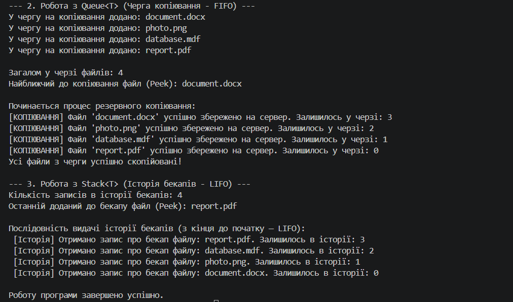
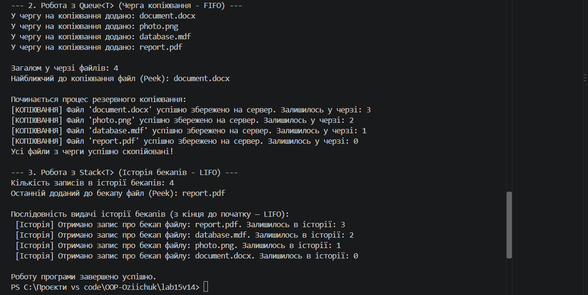

# Лабораторна робота №9

**Студент:** Озійчук Ярослав  
**Варіант:** 14  
**Тема:** HashSet/Queue/Stack: практичні сценарії  

---

## Мета роботи
Навчитися використовувати спеціалізовані колекції `HashSet<T>`, `Queue<T>`, `Stack<T>` для розв'язання практичних задач, зрозуміти їхні особливості та сценарії застосування.

---

## Опис реалізації

У проєкті реалізовано модель **Системи резервного копіювання** згідно з варіантом 14, де кожна підзадача використовує відповідну спеціалізовану колекцію:

1. **`HashSet<string>` — Унікальні файли для бекапу:**
   - Використовується для автоматичного відсіювання дублікатів із вхідного списку файлів, що надходять на резервне копіювання.
   - Продемонстровано основні операції: ініціалізація з колекції з дублікатами, перевірка наявності (`Contains()`), додавання нового унікального файлу (`Add()`) та видалення (`Remove()`).

2. **`Queue<string>` — Черга файлів на копіювання (FIFO):**
   - Забезпечує обробку файлів у строгому порядку їх надходження за дисципліною *First In, First Out*.
   - Продемонстровано додавання файлів у чергу (`Enqueue()`), перегляд першого елемента без видалення (`Peek()`) та послідовне вилучення файлів під час імітації копіювання (`Dequeue()`).

3. **`Stack<string>` — Історія бекапів (LIFO):**
   - Зберігає журнал успішно скопійованих файлів за принципом *Last In, First Out* (останній скопійований файл відображається в історії першим).
   - Продемонстровано запис в історію (`Push()`), перегляд останнього збереженого файлу (`Peek()`) та почергове вилучення записів з вершини стека (`Pop()`).

---

## Результат виконання програми

---

## Відповіді на контрольні запитання

1. **У чому різниця між `List<T>` та `HashSet<T>`?**  
   `List<T>` — це впорядкований список за індексами, який дозволяє зберігати дублікати, а пошук елемента в ньому виконується лінійним перебором за час $O(N)$. `HashSet<T>` — це неупорядкована колекція виключно унікальних елементів, яка автоматично ігнорує дублікати та виконує операції пошуку, додавання й видалення в середньому за $O(1)$ завдяки використанню хеш-таблиці.

2. **Коли доцільно використовувати `Queue<T>` замість `List<T>`?**  
   `Queue<T>` доцільно використовувати тоді, коли задача вимагає обробки даних строго в порядку черги за принципом **FIFO** (першим прийшов — першим пішов), наприклад, для черги завдань, запитів чи копіювання файлів. Видалення елемента з початку черги (`Dequeue()`) у `Queue<T>` працює за $O(1)$, тоді як видалення першого елемента у `List<T>` (`RemoveAt(0)`) вимагає зсуву всіх наступних елементів і займає $O(N)$ часу.

3. **Наведіть приклад реальної задачі, де потрібен `Stack<T>`.**  
   Реалізація механізму скасування дій (**Undo**) у текстових та графічних редакторах, історія переходів «Назад» у веббраузері, перевірка правильності розставлення дужок у виразах, обхід графів і дерев у глибину (DFS), а також ведення журналу останніх виконаних операцій (LIFO).

4. **Яка складність операції `Contains()` для `HashSet<T>` і чому?**  
   Часова складність операції `Contains()` становить **$O(1)$ в середньому**. Це досягається завдяки внутрішній структурі хеш-таблиці: при пошуку обчислюється хеш-код елемента (`GetHashCode()`), який одразу вказує на конкретний кошик (bucket) у пам'яті, де знаходиться елемент, без необхідності перебирати всю колекцію.

5. **Чому `Queue<T>` називають FIFO, а `Stack<T>` — LIFO?**  
   - **FIFO** (*First In, First Out* — «першим увійшов, першим вийшов») — у черзі перший доданий елемент завжди буде оброблений і вилучений найпершим.  
   - **LIFO** (*Last In, First Out* — «останнім увійшов, першим вийшов») — у стеку елементи додаються і забираються лише з одного кінця (вершини), тому останній доданий елемент вилучається першим.