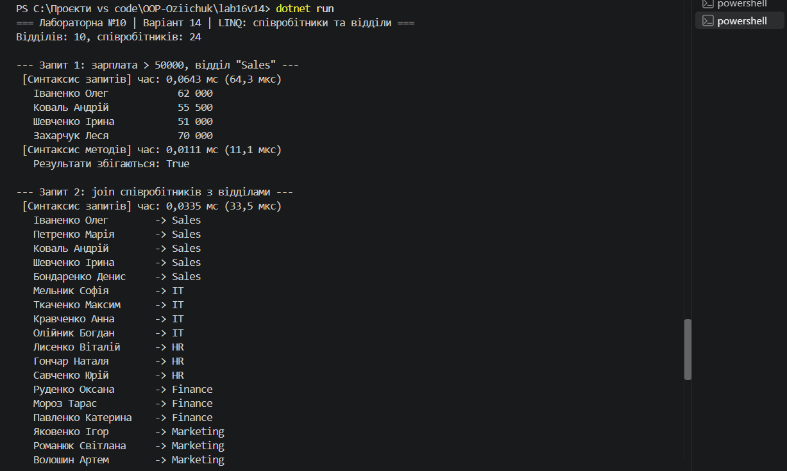
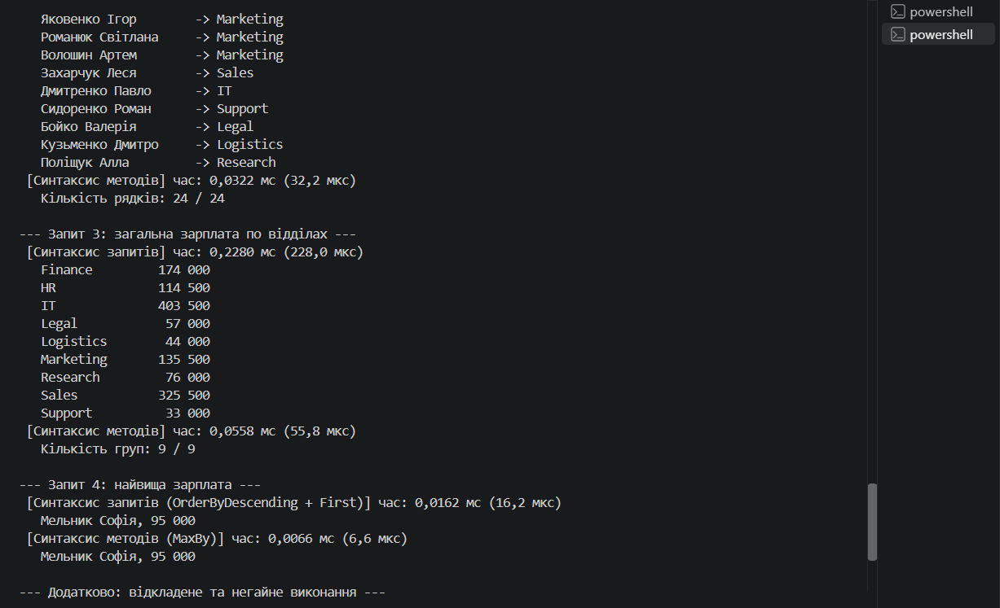
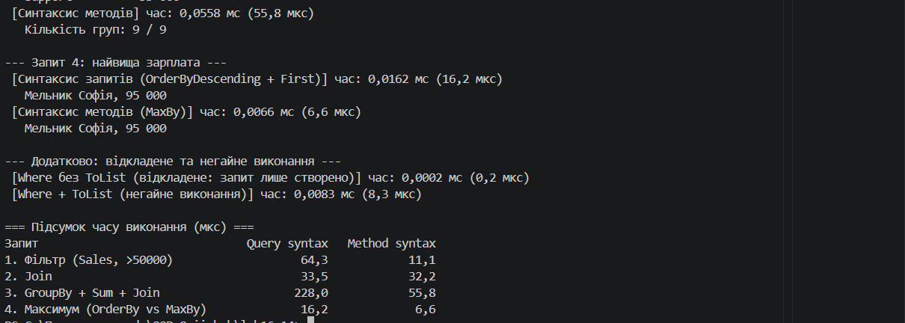

# Лабораторна робота №10

**Студент:** Озійчук Ярослав  
**Варіант:** 14  
**Тема:** LINQ в дії: фільтри, join, агрегації. Продуктивність  

---

## Мета роботи
Навчитися ефективно використовувати LINQ для фільтрації, об'єднання (`join`) та агрегації даних, а також аналізувати продуктивність LINQ-запитів за допомогою `Stopwatch`.

---

## Опис реалізації

У проєкті `lab16v14` реалізовано модель **Управління співробітниками** згідно з варіантом 14.

### Класи сутностей (папка `Models`)

1. **`Department`** — відділ компанії: `Id`, `Name`, `Budget`.
2. **`Employee`** — співробітник: `Id`, `Name`, `DepartmentId`, `Salary`.

Зв'язок між класами: `Employee.DepartmentId` → `Department.Id` (багато до одного).

### Тестові дані

- **10 відділів:** Sales, IT, HR, Finance, Marketing, Support, Legal, Logistics, Research, Security.
- **24 співробітники.** У відділі "Sales" є і ті, хто отримує більше 50000, і ті, хто менше, тому фільтр дає змістовний результат.

### LINQ-запити

Кожен запит реалізовано в **синтаксисі запитів** і в **синтаксисі методів**, а час виконання виміряно через `System.Diagnostics.Stopwatch`.

1. **Фільтрація.** Співробітники із зарплатою > 50000 у відділі "Sales".
   - Query syntax: `from ... join ... where ... select`.
   - Method syntax: `Where(...)` з перевіркою відділу через `Any()`.
2. **Об'єднання (`join`).** Ім'я співробітника та назва його відділу.
   - Query syntax: `from e in employees join d in departments on ... equals ...`.
   - Method syntax: `employees.Join(departments, ...)`.
3. **Агрегація.** Загальна зарплата для кожного відділу.
   - Query syntax: `group ... by ... into g join ... orderby ...` та `g.Sum(...)`.
   - Method syntax: `GroupBy(...).Join(...).OrderBy(...)`.
4. **Пошук максимуму.** Співробітник з найвищою зарплатою.
   - Query syntax: `orderby e.Salary descending` + `First()`.
   - Method syntax: `MaxBy(e => e.Salary)`.

Додатково продемонстровано різницю між **відкладеним** (`Where` без `ToList()`) та **негайним** (`Where` + `ToList()`) виконанням.

### Організація вимірювання часу

Кожен запит перед заміром виконується один раз для прогріву (JIT-компіляція), щоб перший запит не здавався повільнішим лише через першу компіляцію. Замір охоплює виконання запиту разом із матеріалізацією результату (`ToList()` / `First()`).

---

## Результат виконання програми

Підсумок часу виконання (мкс). Значення коливаються від запуску до запуску, наведено типовий запуск:

| Запит | Query syntax | Method syntax |
|---|---:|---:|
| 1. Фільтр (Sales, > 50000) | 29.4 | 15.7 |
| 2. Join | 18.1 | 5.3 |
| 3. GroupBy + Sum + Join | 142.5 | 40.5 |
| 4. Максимум (OrderBy vs MaxBy) | 9.2 | 2.0 |

---

## Висновки про продуктивність

1. **Синтаксис не впливає на швидкість.** Компілятор перетворює query syntax на ті самі виклики методів (`Where`, `Join`, `GroupBy`, `OrderBy`). Щоб це перевірити, я поміняв порядок виконання варіантів місцями: у запитах 2 і 3 повільнішим виявлявся той варіант, який виконувався першим, а не той, що написаний в іншому синтаксисі. Тож різниця там є артефактом вимірювання (кеш процесора, рівні JIT, збирач сміття).
2. **Запит 1.** Різниця реальна, бо варіанти відрізняються за суттю: query-варіант використовує `join` (будує хеш-таблицю відділів), а method-варіант — `Any()` (перебір відділів без створення структур). На малих колекціях `Any()` дешевший. На великих `join` виграє: складність `O(n + m)` проти `O(n·m)`.
3. **Запит 4.** `OrderByDescending().First()` стабільно повільніший за `MaxBy()`, приблизно у 4-5 разів. Сортування має складність `O(n log n)` і створює відсортовану копію, а `MaxBy()` робить один прохід `O(n)`. Для пошуку максимуму сортувати не варто.
4. **Найдорожчим за обсягом роботи є запит 3** (`GroupBy` + `Join` + `OrderBy`): він створює групи з проміжними колекціями, потім виконує з'єднання й сортування. Тому його абсолютний час найбільший.
5. **Відкладене та негайне виконання.** `Where` без `ToList()` майже нічого не коштує, бо лише створює запит. Реальна робота виникає при `ToList()`, `First()`, `Sum()` тощо. Тому `Stopwatch` потрібно ставити навколо матеріалізації результату.
6. **Загальний висновок.** Дорожчі ті операції, що створюють проміжні структури або сортують (`GroupBy`, `Join`, `OrderBy`), дешевші — однопрохідні (`Where`, `MaxBy`). На 24 елементах абсолютні значення (мікросекунди) мало що означають: для надійної оцінки потрібні більші набори даних і багаторазові заміри (наприклад, BenchmarkDotNet).