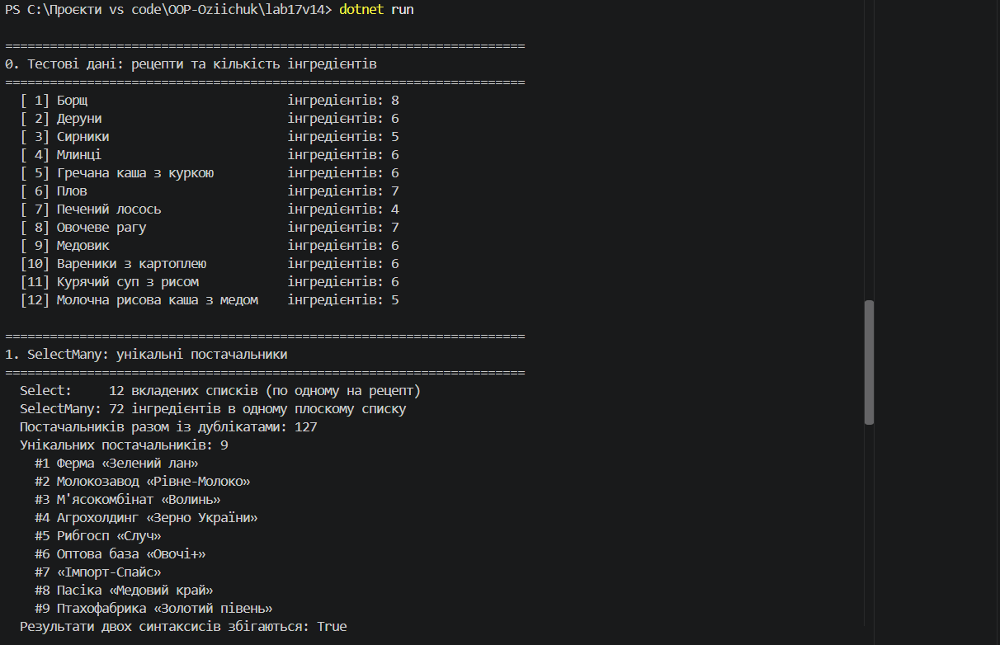
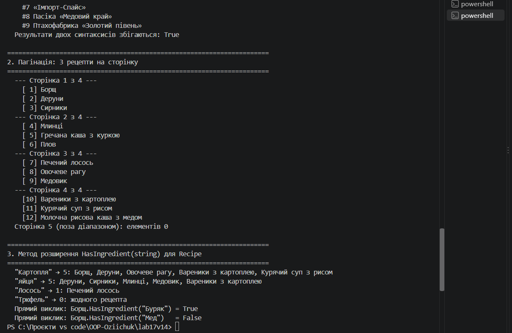

# Лабораторна робота №11

**Студент:** Озійчук Ярослав  
**Варіант:** 14  
**Тема:** LINQ: SelectMany, пагінація й custom extensions  

---

## Мета роботи
Навчитися використовувати `SelectMany` для роботи з вкладеними колекціями, реалізовувати пагінацію за допомогою `Skip`/`Take`, а також створювати власні методи розширення (extension methods).

---

## Опис реалізації

У проєкті `lab17v14` реалізовано сценарій варіанта 14: **рецепти та їхні інгредієнти з постачальниками**.

### Класи сутностей (папка `Models`)

1. **`Supplier`** — постачальник: `Id`, `Name`.
2. **`Ingredient`** — інгредієнт: `Id`, `Name`, `List<Supplier> Suppliers`.
3. **`Recipe`** — рецепт: `Id`, `Name`, `List<Ingredient> Ingredients`.

Вкладеність: `Recipe` → `Ingredient` → `Supplier` (два рівні вкладених колекцій).

### Тестові дані (`Data/SampleData.cs`)

- **12 рецептів** (Борщ, Деруни, Сирники, Млинці, Плов, Медовик тощо);
- **23 інгредієнти** й **9 постачальників**;
- одні й ті самі об'єкти інгредієнтів і постачальників використовуються в кількох рецептах, тому після `SelectMany` з'являються дублікати (72 записи інгредієнтів, 127 записів постачальників), які потрібно прибрати.

### Запити

1. **`SelectMany`.** Усі унікальні постачальники з усіх інгредієнтів усіх рецептів.
   - Синтаксис методів: `SelectMany(r => r.Ingredients).SelectMany(i => i.Suppliers).DistinctBy(s => s.Id)`.
   - Синтаксис запитів: `from r in recipes from i in r.Ingredients from s in i.Suppliers select s`.
   - Для порівняння показано `Select` (повертає 12 вкладених списків) і `SelectMany` (один плоский список).
   - `DistinctBy(s => s.Id)` використано замість `Distinct()`, бо для класу `Supplier` не перевизначено `Equals`, а порівняння за посиланням залежало б від того, що об'єкти спільні.
2. **Пагінація.** Рецепти по 3 на сторінку (`Skip((page - 1) * pageSize).Take(pageSize)`). Виведено всі 4 сторінки поспіль, а також запит поза діапазоном (порожній результат).
3. **Власний метод розширення.** `HasIngredient(this Recipe recipe, string ingredientName)` — перевіряє наявність інгредієнта без урахування регістру та зайвих пробілів. Продемонстровано в `Where(...)` та прямим викликом.

Додатково створено узагальнені методи розширення `Paginate<T>(page, pageSize)` і `PageCount<T>(pageSize)` для `IEnumerable<T>` (папка `Extensions`), щоб логіка пагінації не дублювалась у `Main`.

---

## Результат виконання програми

---

## Висновки

1. `SelectMany` «розгортає» вкладені колекції в одну послідовність. На відміну від `Select`, який повертає колекцію колекцій, він дає плоский список: 12 рецептів → 72 інгредієнти → 127 постачальників (з дублікатами).
2. Після розгортання з'являються повтори, тому для унікальності потрібен `DistinctBy` (або `Distinct` із коректним `Equals`). Лишилось 9 унікальних постачальників.
3. Синтаксис запитів (кілька `from`) і синтаксис методів (`SelectMany`) дають однаковий результат, бо компілятор перетворює перший на другий. Програма це перевіряє через `SequenceEqual`.
4. Пагінація через `Skip`/`Take` проста, але вимагає правильного підрахунку сторінок: `(count + pageSize - 1) / pageSize`. Номер сторінки і розмір сторінки перевіряються, щоб уникнути від'ємного `Skip`.
5. Метод розширення дозволяє додати бізнес-логіку до `Recipe`, не змінюючи сам клас, і добре поєднується з LINQ: `recipes.Where(r => r.HasIngredient("Картопля"))`.

---

## Відповіді на контрольні питання

1. **Для чого `SelectMany`?** Він проєктує кожен елемент у колекцію й об'єднує всі ці колекції в одну. `Select` для `recipes.Select(r => r.Ingredients)` поверне `IEnumerable<List<Ingredient>>` (12 списків), а `SelectMany` — `IEnumerable<Ingredient>` (72 елементи).
2. **Пагінація.** Методи `Skip(n)` (пропустити n елементів) і `Take(m)` (взяти m). Для сторінки `page` розміром `pageSize`: `Skip((page - 1) * pageSize).Take(pageSize)`.
3. **Методи розширення.** Це статичні методи у статичному класі, перший параметр якого позначено `this`. Їх викликають як методи екземпляра. Сам LINQ реалізований як набір методів розширення для `IEnumerable<T>` (`System.Linq.Enumerable`), тому власні методи вбудовуються в ті самі ланцюжки викликів.
4. **Приклад.** `HasIngredient(this Recipe recipe, string name)` перевіряє, чи є в рецепті інгредієнт із такою назвою. Узагальнений приклад — `Paginate<T>(this IEnumerable<T> source, int page, int pageSize)`.
