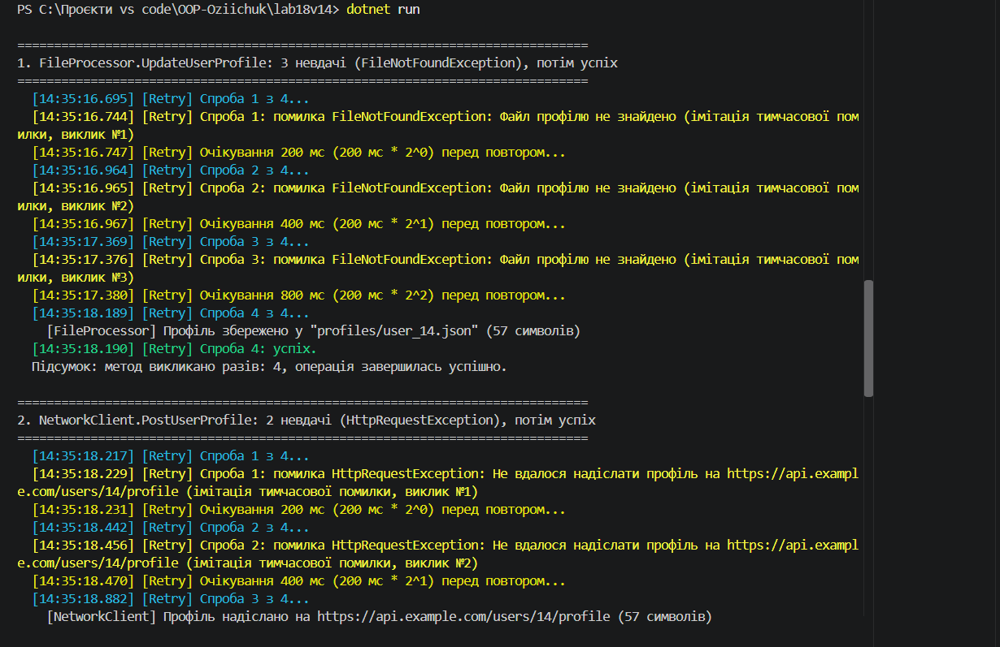
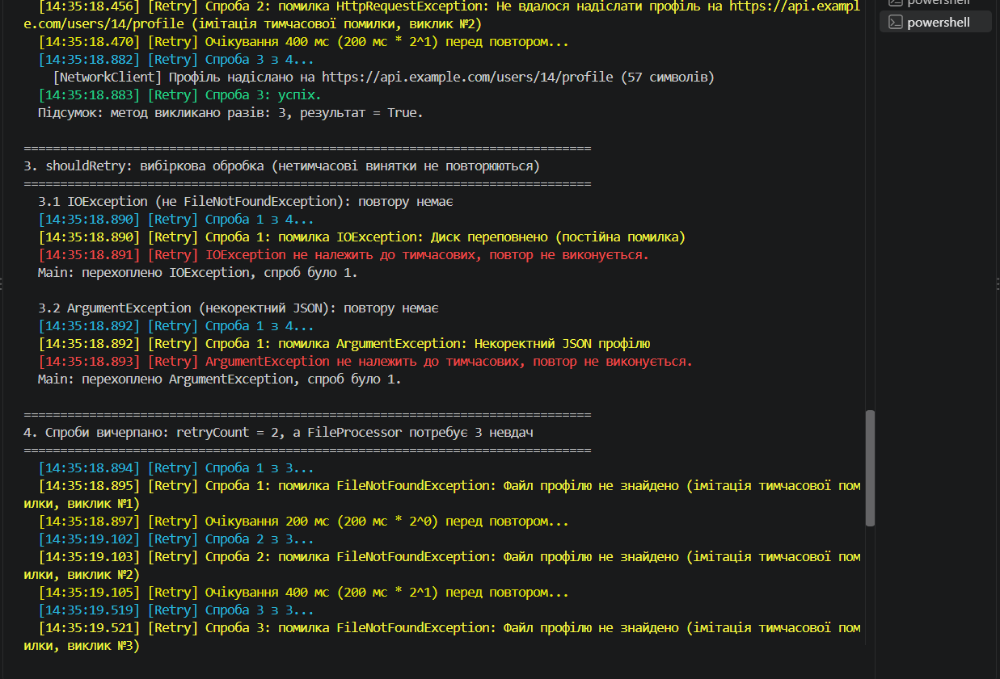
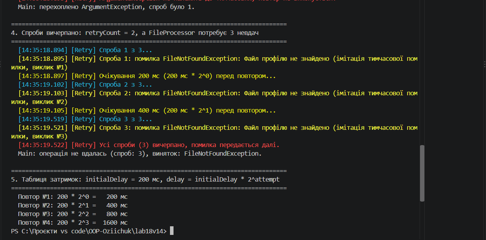

# Лабораторна робота №12

**Студент:** Озійчук Ярослав  
**Варіант:** 14  
**Тема:** Обробка IO/мережевих помилок та патерн Retry  

---

## Мета роботи
Навчитися обробляти помилки вводу/виводу та мережеві помилки за допомогою `try-catch`, а також реалізувати узагальнений патерн Retry з експоненційною затримкою.

---

## Опис реалізації

У проєкті `lab18v14` реалізовано сценарій варіанта 14: **оновлення профілю користувача**.

### Класи (папка `Services`)

1. **`FileProcessor`** — імітує роботу з файлами.
   - `void UpdateUserProfile(string path, string profileJson)`;
   - перші **3** виклики кидає `FileNotFoundException`, далі успіх.
2. **`NetworkClient`** — імітує мережеві запити.
   - `bool PostUserProfile(string url, string profileJson)`;
   - перші **2** виклики кидає `HttpRequestException`, далі повертає `true`.
3. **`RetryHelper`** — статичний допоміжний клас.
   - `T ExecuteWithRetry<T>(Func<T> operation, int retryCount = 3, TimeSpan initialDelay = default, Func<Exception, bool> shouldRetry = null)`;
   - перевантаження для `Action`, щоб можна було повторювати `void`-методи (`UpdateUserProfile`).

Лічильник викликів у `FileProcessor` і `NetworkClient` дозволяє імітувати «тимчасову» помилку: кількість невдач задається в конструкторі (за замовчуванням — значення варіанта).

### Як працює `RetryHelper`

- `retryCount` — кількість **повторних** спроб, тож усього спроб `retryCount + 1`.
- Затримка перед повтором: `initialDelay * 2^attempt`, де `attempt` — номер невдалої спроби з нуля. Для `initialDelay = 200 мс`: 200 → 400 → 800 мс.
- Якщо `initialDelay` не передано (`default`), використовується 500 мс.
- `shouldRetry` вирішує, чи повторювати для конкретного винятку. Якщо він повернув `false` або спроби вичерпано, виняток передається далі через `throw;` (зберігається оригінальний стек викликів).
- Кожна спроба, причина невдачі, затримка й підсумок логуються з часовою позначкою.

### Сценарії в `Main`

1. `FileProcessor`: 3 невдачі → успіх на 4-й спробі.
2. `NetworkClient`: 2 невдачі → успіх на 3-й спробі.
3. Вибіркова обробка через `shouldRetry`: `IOException` і `ArgumentException` не є тимчасовими, тому повтор не виконується (1 спроба).
4. Спроби вичерпано (`retryCount = 2`, потрібно 3 невдачі): виняток потрапляє в `Main`.
5. Таблиця затримок за формулою.

`shouldRetry` для варіанта 14: `ex is FileNotFoundException or HttpRequestException`. Звичайний `IOException` цим предикатом не проходить, бо `FileNotFoundException` успадковується від `IOException`, а не навпаки.

---

## Результат виконання програми

---

## Висновок

Експоненційна затримка подвоюється після кожної невдачі: для `initialDelay = 200 мс` повтори відбуваються через 200, 400 і 800 мс (формула `initialDelay * 2^attempt`). Для `FileProcessor` це 1400 мс загального очікування до успішної 4-ї спроби, для `NetworkClient` — 600 мс до 3-ї. Так сервіс отримує дедалі більше часу на відновлення, а його не засипають частими запитами, а делегат `shouldRetry` не дозволяє марно повторювати постійні помилки (`IOException`, `ArgumentException`).

---

## Відповіді на контрольні запитання

1. **Типові винятки.** Файли: `FileNotFoundException`, `DirectoryNotFoundException`, `IOException`, `UnauthorizedAccessException`. Мережа: `HttpRequestException`, `SocketException`, `TaskCanceledException` (тайм-аут).
2. **Патерн Retry.** Операцію, що могла впасти через тимчасову причину, виконують повторно задану кількість разів, зазвичай із паузами. Доцільний для тимчасових збоїв: обрив зв'язку, перевантажений сервер, заблокований файл. Недоцільний для постійних помилок (неправильні дані, відсутність прав) і для неідемпотентних операцій без додаткового захисту.
3. **Експоненційна затримка.** Пауза перед кожним повтором збільшується вдвічі: `delay = initialDelay * 2^attempt`. У коді: `TimeSpan.FromTicks(initialDelay.Ticks * (1L << attempt))`.
4. **Навіщо `shouldRetry`.** Він дозволяє повторювати лише ті винятки, які мають тимчасовий характер, а решту одразу пропускати далі. Без нього `RetryHelper` витрачав би час на безглузді повтори.
