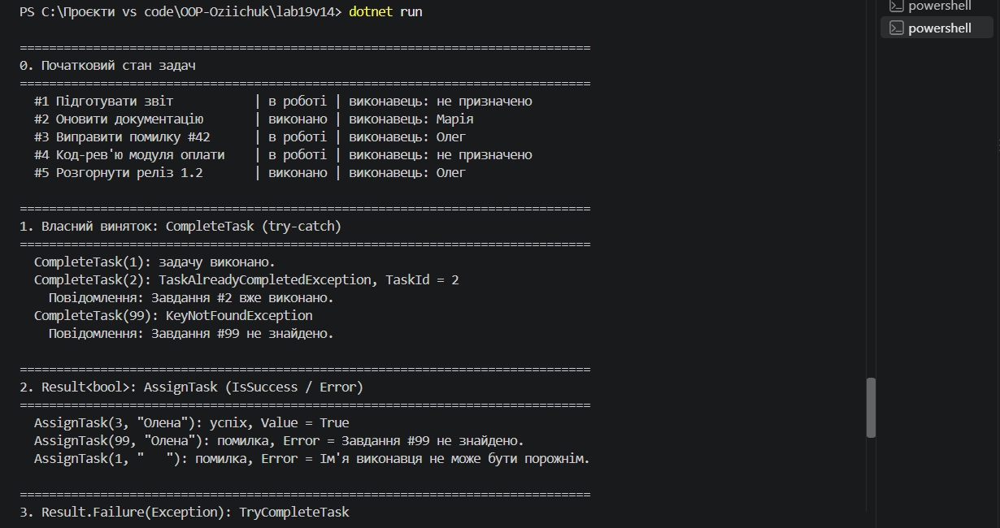
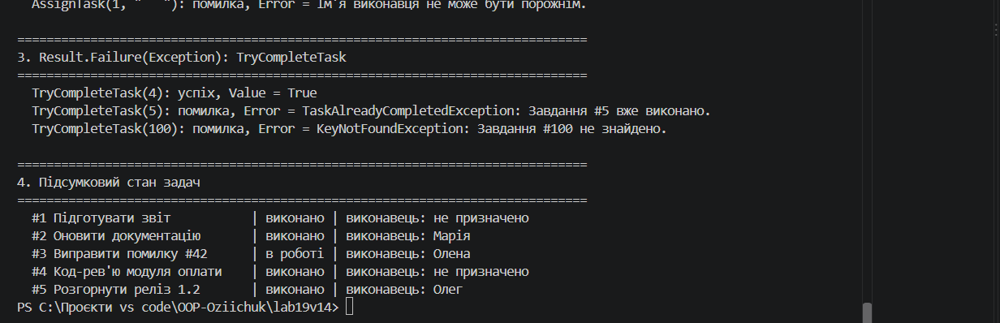

# Лабораторна робота №13

**Студент:** Озійчук Ярослав  
**Варіант:** 14  
**Тема:** Власні винятки та патерн Result  

---

## Мета роботи
Навчитися створювати власні типи винятків для специфічних помилок і реалізовувати патерн `Result<T>` для обробки очікуваних невдач без викидання винятків.

---

## Опис реалізації

У проєкті `lab19v14` реалізовано сценарій варіанта 14: **управління задачами**.

### Структура проєкту

- `Exceptions/TaskAlreadyCompletedException.cs` — власний виняток;
- `Common/Result.cs` — узагальнений клас `Result<T>`;
- `Models/TaskItem.cs` — модель задачі (`Id`, `Title`, `IsCompleted`, `Assignee`). Названа `TaskItem`, щоб не конфліктувати з `System.Threading.Tasks.Task`;
- `Services/TaskService.cs` — сервіс із тестовими даними (5 задач).

### Власний виняток `TaskAlreadyCompletedException`

- успадкований від `Exception`, має властивість `TaskId`;
- стандартні конструктори: `()`, `(string message)`, `(string message, Exception innerException)`;
- додаткові конструктори `(int taskId)` і `(int taskId, Exception innerException)`, які формують повідомлення з номером задачі;
- конструктор для серіалізації `(SerializationInfo, StreamingContext)` та `GetObjectData`. У .NET 8+ цей механізм вважається застарілим (`SYSLIB0051`), тому попередження вимкнено директивою `#pragma`.

### Клас `Result<T>`

- властивості `IsSuccess`, `Value`, `Error` (додатково `IsFailure`);
- приватний конструктор `Result(T value, bool isSuccess, string error)`;
- фабричні методи `Success(T value)`, `Failure(string error)` та `Failure(Exception ex)`. Останній формує помилку у вигляді «ТипВинятку: повідомлення».

### Клас `TaskService`

| Метод | Підхід | Коли виникає помилка |
|---|---|---|
| `void CompleteTask(int taskId)` | **виняток** | `TaskAlreadyCompletedException`, якщо задача вже виконана; `KeyNotFoundException`, якщо задачі немає |
| `Result<bool> AssignTask(int taskId, string assignee)` | **Result** | задачу не знайдено або порожнє ім'я виконавця |
| `Result<bool> TryCompleteTask(int taskId)` | **Result** | обгортка над `CompleteTask`: ловить очікувані винятки й повертає `Result.Failure(ex)` |

`TryCompleteTask` додано, щоб показати метод `Failure(Exception)` у роботі та наочно порівняти обидва підходи на одній і тій самій операції.

### Чому саме так

- Повторне виконання вже виконаної задачі означає порушення послідовності дій у коді, що викликає метод, тому тут доречний виняток зі спеціальними даними (`TaskId`).
- Пошук задачі за номером, який ввів користувач, і порожнє ім'я виконавця — звичайні, очікувані ситуації. Для них `Result<T>` читабельніший і не використовує дорогий механізм винятків.

---

## Результат виконання програми

---

## Висновок

Для `CompleteTask` обрано виняток, бо повторне завершення задачі — це порушення стану, яке викликач має явно обробити (`catch`), і виняток несе додаткові дані (`TaskId`). Для `AssignTask` обрано `Result<bool>`, бо відсутня задача чи порожнє ім'я — типові помилки вводу, які не варто «підіймати» як винятки: результат перевіряється через `IsSuccess` / `Error`. Метод `TryCompleteTask` показує, що між двома підходами можна переходити за допомогою `Result<T>.Failure(Exception)`.

---

## Відповіді на контрольні запитання

1. **Навіщо власні винятки.** Вони точно описують помилку предметної області (`TaskAlreadyCompletedException` зрозуміліше за `InvalidOperationException`), дозволяють ловити її окремим `catch`, а також нести додаткові дані (`TaskId`).
2. **Стандартні конструктори.** Без параметрів `()`, з повідомленням `(string message)`, з повідомленням і внутрішнім винятком `(string message, Exception innerException)`, а також для серіалізації `(SerializationInfo, StreamingContext)` (у .NET 8+ застарілий).
3. **Патерн Result.** Метод повертає об'єкт, що містить або значення, або помилку, і викликач перевіряє `IsSuccess`. Доцільніший за винятки, коли невдача — звичайний очікуваний сценарій (валідація вводу, «не знайдено»), частий, і не потребує переривання потоку виконання.
4. **Що де.** Винятки — для справді виняткових ситуацій і порушень контракту: пошкоджені дані, неприпустимий стан, збої інфраструктури. `Result` — для очікуваних бізнес-помилок і валідації. У цій роботі: `CompleteTask` (виняток) проти `AssignTask` (Result).
