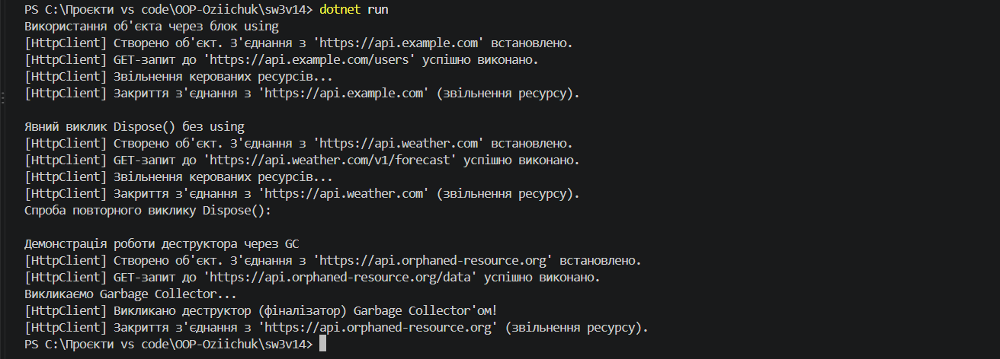

# Лабораторна робота №3 
**Тема:** Життєвий цикл об’єкта та керування ресурсами.

## Відповіді на контрольні запитання

1. Що таке життєвий цикл об’єкта в .NET?   
Це етапи існування об'єкта в пам'яті: створення (виділення пам'яті в купі та виклик конструктора) -> використання (через посилання) -> збирання сміття (GC позначає об'єкт без посилань) -> фіналізація/деструкція (необов'язковий виклик деструктора) -> звільнення пам'яті.   
2. Яка різниця між керованими та некерованими ресурсами?   
Керовані ресурси (Managed) — це об'єкти .NET, чия пам'ять очищується автоматично збирачем сміття (GC). Некеровані ресурси (Unmanaged) — це файлові дескриптори, мережеві з'єднання, відкриті сокети, які GC не може контролювати самостійно, тому вони потребують явного закриття/звільнення розробником.   
3. Для чого призначений інтерфейс IDisposable?   
Інтерфейс надає стандартний механізм (метод Dispose()) для детермінованого (негайного та передбачуваного) звільнення некерованих ресурсів за бажанням розробника, не чекаючи виклику GC.   
4. Як оператор using допомагає в керуванні ресурсами?   
Оператор using є синтаксичним цукром для конструкції try-finally. Він гарантує, що метод Dispose() буде викликано автоматично під час виходу з блоку using, навіть якщо всередині виникне виняткова ситуація (exception).   
5. Навіщо в патерні Dispose використовується метод GC.SuppressFinalize()?   
GC.SuppressFinalize(this) повідомляє збирачу сміття, що ресурси об'єкта вже звільнені детерміновано через Dispose(), тому викликати деструктор (фіналізатор) більше непотрібно. Це підвищує продуктивність програми.   
6. Чому в деструкторі викликається Dispose(false), а в методі Dispose() — Dispose(true)?   Dispose(true) означає, що виклик відбувся явно (ручно або через using), тому можна безпечно очищувати як керовані, так і некеровані ресурси.   Dispose(false) викликається із деструктора під час фіналізації GC. У цей момент керовані об'єкти вже могли бути зібрані GC, тому звертатися до них небезпечно. Параметр false вказує на те, що потрібно звільняти тільки некеровані ресурси.

---

## Результат виконання програми

