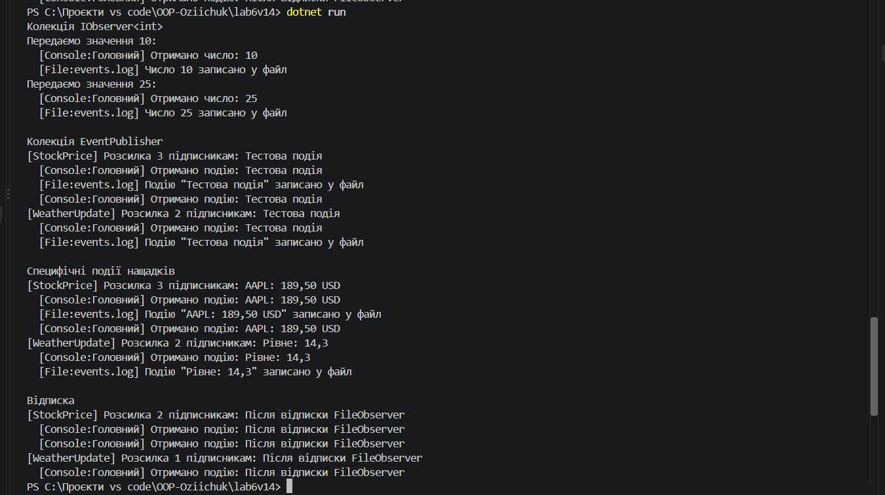

# Лабораторна робота №6

**Студент:** Озійчук  
**Варіант:** 14  
**Тема:** Абстрактні класи та інтерфейси. Контракти та реалізації.  

---

## Мета роботи
Навчитися створювати та використовувати абстрактні класи та інтерфейси для визначення контрактів та реалізації спільної логіки, а також зрозуміти критерії вибору між ними.

---

## Опис реалізації

**Інтерфейс `IObserver<T>`** визначає контракт спостерігача: метод `Update(T value)`. Реалізації:
- `ConsoleObserver` виводить отримане значення в консоль;
- `FileObserver` імітує запис значення у файл повідомленням у консолі.

Обидва класи реалізують `IObserver<int>` (за варіантом) та `IObserver<string>`, бо `EventPublisher` приймає `IObserver<string>`.

**Абстрактний клас `EventPublisher`** містить:
- абстрактні методи `Subscribe` та `Unsubscribe`;
- абстрактну властивість `Name`;
- конкретний метод `NotifySubscribers`, який розсилає подію всім підписникам.

Похідні класи:
- `StockPricePublisher` дозволяє повторну підписку одного спостерігача;
- `WeatherUpdatePublisher` ігнорує дублікати підписки.

У `Main` створено колекцію `List<IObserver<int>>` та колекцію `List<EventPublisher>`, для яких виконано поліморфні виклики методів.

---

## Результат виконання програми

---

## Відповіді на контрольні запитання

**1. У чому полягає основна відмінність між абстрактним класом та інтерфейсом?**  
Абстрактний клас є неповним базовим класом: може мати поля, конструктори, конкретні й абстрактні члени. Інтерфейс є лише контрактом, який описує, що вміє об'єкт, без стану та (як правило) без реалізації.

**2. Коли доцільно використовувати абстрактний клас, а коли інтерфейс?**  
Абстрактний клас підходить для тісно пов'язаних типів зі спільним кодом (`EventPublisher` із загальною розсилкою, `Stream`). Інтерфейс підходить для спільної поведінки непов'язаних типів (`IObserver<T>`, `IDisposable`, `IComparable`).

**3. Чи може клас успадковувати від кількох абстрактних класів? А реалізовувати кілька інтерфейсів?**  
Ні, у C# можна успадковувати лише один клас. Інтерфейсів можна реалізувати скільки завгодно, наприклад `ConsoleObserver` реалізує `IObserver<int>` та `IObserver<string>`.

**4. Як абстрактні класи та інтерфейси сприяють поліморфізму та гнучкості архітектури?**  
Код працює з абстракціями, а не з конкретними типами, тому нові реалізації додаються без зміни наявного коду. Виклик через змінну базового типу виконує версію нащадка, а спільна логіка не дублюється.
